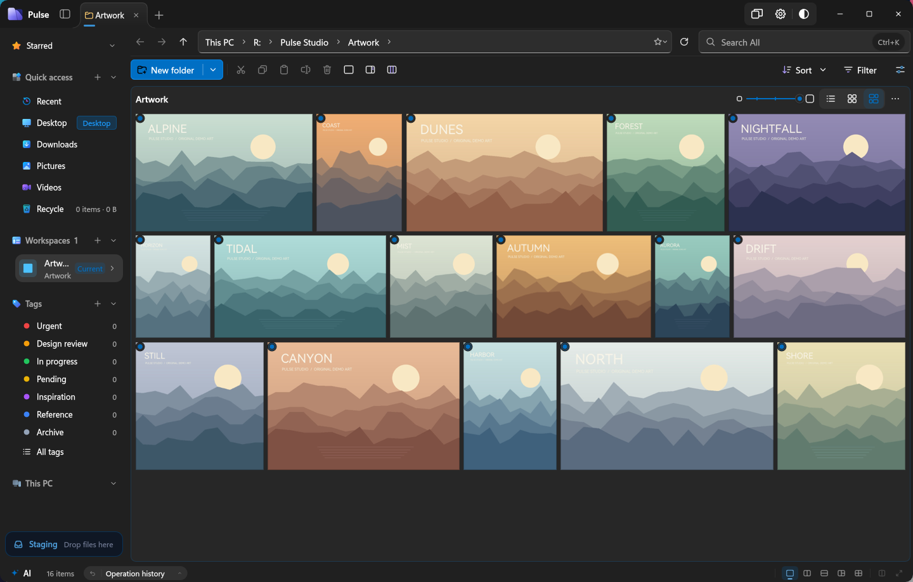
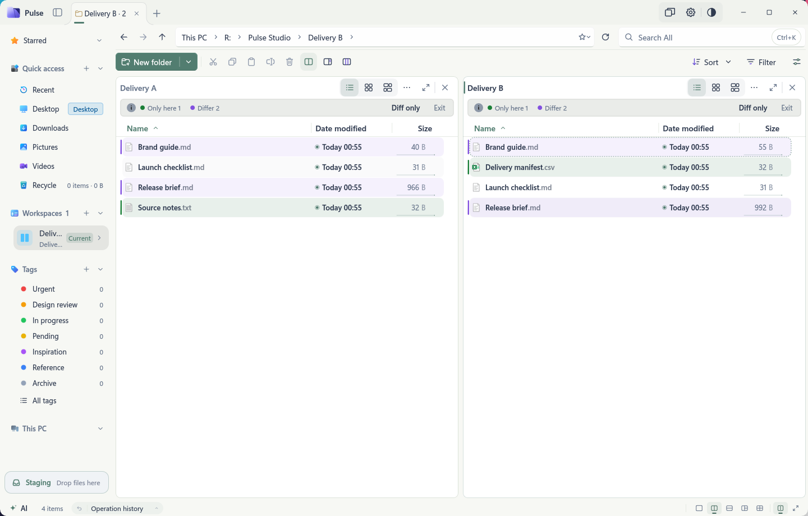
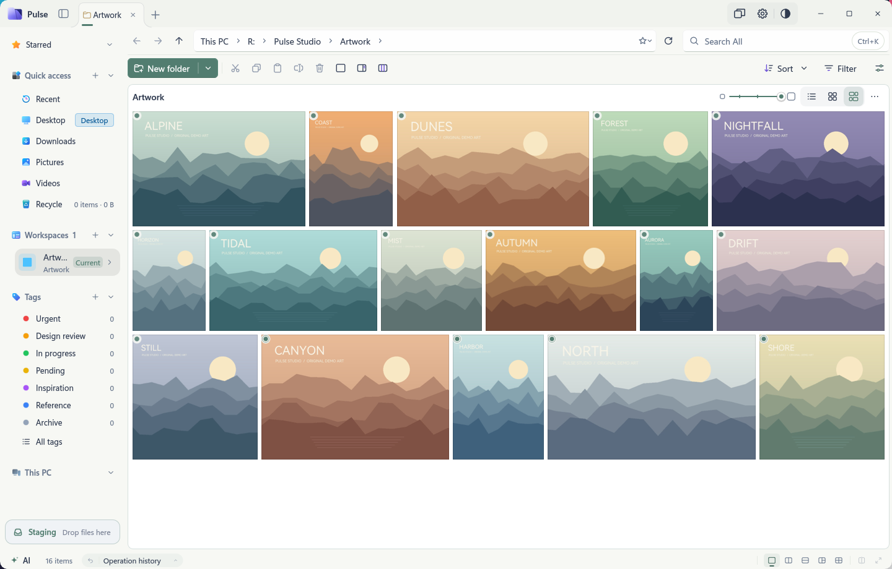
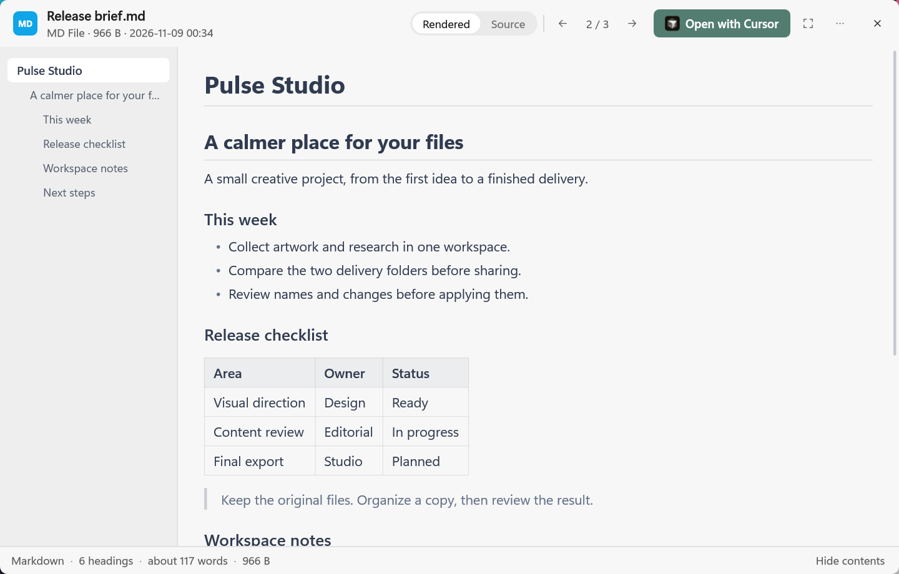
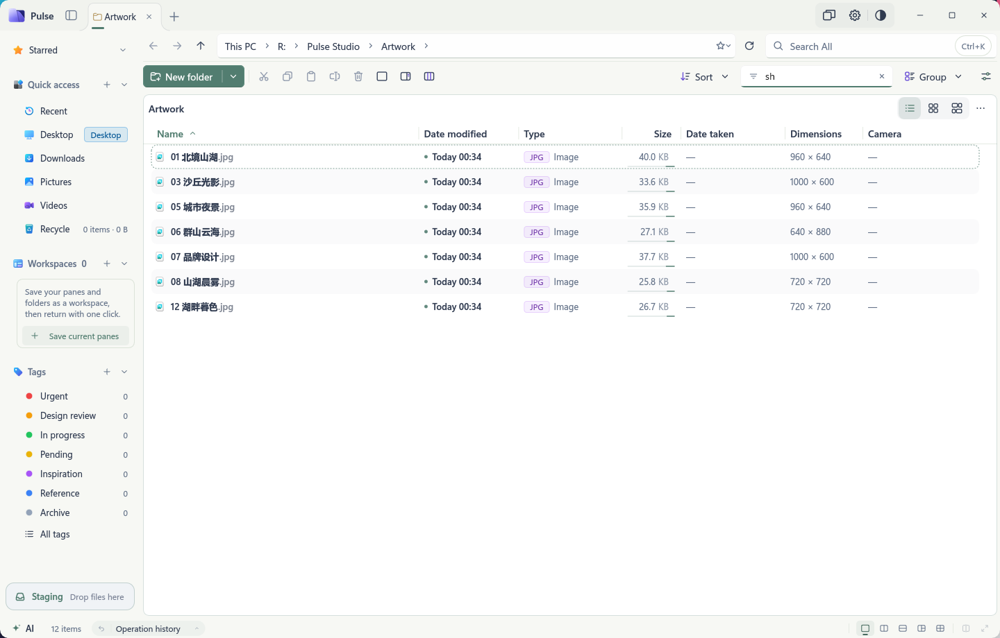
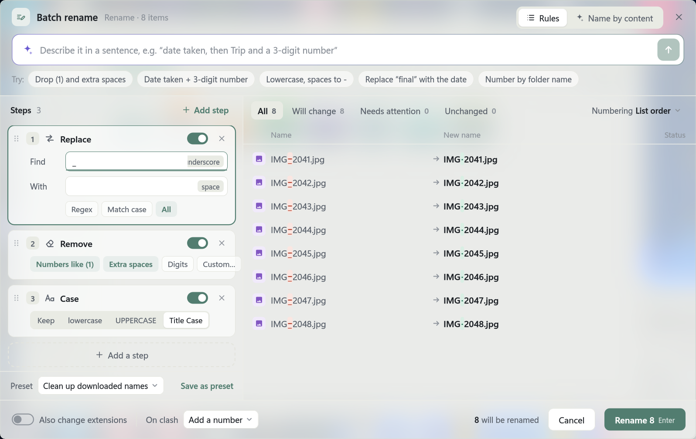
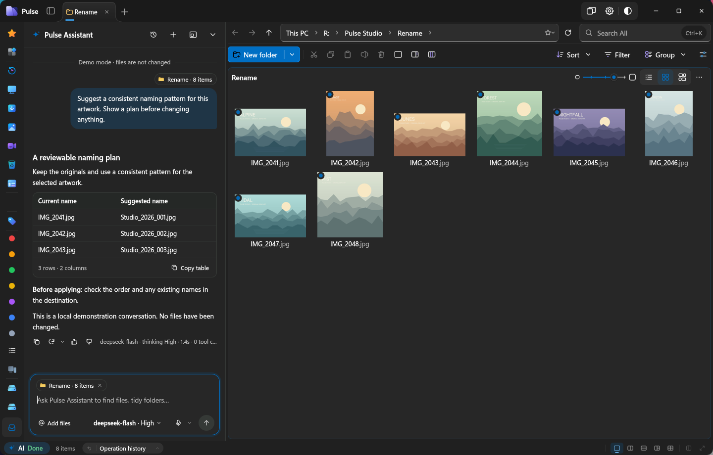

# Pulse


**More than opening folders: bring your files, creative assets and everyday work together.**

A file manager for Windows with multiple panes and saved workspaces, indexed and pinyin search, rich previews, a photo wall, tags and aliases, batch renaming with previews, and a Pulse assistant that proposes a plan for you to approve.

[Download the latest release](https://github.com/jimmgreen/pulse/releases/latest) · [1.0.59 release notes](docs/releases/1.0.59.en.md) · [Release history](https://github.com/jimmgreen/pulse/releases) · [Report an issue](https://github.com/jimmgreen/pulse/issues) · [简体中文](README.md)

> The current source version is **1.0.59**; see Releases for available downloads. Supports Windows 10/11 x64, with a separate Windows 8.1 x64-compatible edition. The interface supports Simplified Chinese, Traditional Chinese and English.



## Turn your go-to folders into a workspace

- **Multiple panes, not just multiple windows**: side-by-side, stacked, three-pane, four-pane and column browsing. Each tab keeps its folder combination and layout; drag panes to swap their positions.
- **Save a workspace**: keep an “Assets → Project → Delivery” setup and restore it in the current tab or a new one. Names, colors and hierarchy help distinguish projects.
- **Arrange multiple windows together**: Ctrl+N opens a window. Window overview offers side-by-side, tiled, main-and-secondary, cascade and merge layouts, with undo for arrangements.
- **Make the toolbar your own**: pin commands and programs, reorder them and add separators. Customize keyboard shortcuts and context-menu preferences, too.
- **Views remembered per folder**: Details, icons, list, content and photo wall, with saved sorting, grouping and column settings.

### See what differs before you deliver

Two-pane folder comparison marks items found on only one side, newer or older versions, and other differences. Show only differences to check two delivery folders more easily.



> Folder comparison uses metadata such as names, timestamps and sizes from the two current listings. It does not recursively verify file contents or synchronize files automatically. Text-content comparison is a separate feature.

## Browse your assets without opening every app

### A photo wall that keeps each image's proportions

Landscape images, portraits and videos fit together at their own aspect ratios instead of being cropped into identical squares. Adjust the display size and use image dimensions, date taken, music or video metadata columns to find what you need.



### Press Space to preview, or browse with the Details sidebar

- Rendered Markdown, syntax-highlighted code, paged PDFs and folder contents.
- CSV / TSV / XLSX tables, collapsible JSON / XML trees, Jupyter notebook cells, and documents such as DOCX / EPUB.
- Images, animated GIF / WebP / APNG and video playback, with seeking, playback shortcuts and click-to-pause.
- Hover preview cards, configurable mouse press-and-hold previews, and a Details sidebar in the main window let you skim files without interrupting your work.
- Built-in ZIP previews. **7z/RAR previews and extraction require a separately installed and enabled native archive plugin**; they are not included by default.



Format support depends on enhancement packs and system components. Check Settings → Quick Look for details.

## Find it, then keep working

- **Whole-drive file-name search**: search with the PulseIndex service, or narrow the scope to the current folder or another folder.
- **Find Chinese names with pinyin**: full spellings, initials, polyphonic characters and highlighted matches. For example, typing `sh` in the current folder can match Chinese names such as “品牌设计”, “城市夜景” and “山湖晨雾”.
- **Full-text search**: install the content-search enhancement pack on demand to search text, code, PDF, Word, Excel, PowerPoint and more, with results streamed as they arrive.
- **Global quick search**: once enabled, press Alt+Space or tap Ctrl twice to find files, frequent folders and Start menu apps. Preview, select multiple results, copy them or add them to the staging tray.
- **Continue in the main window**: press Shift+Enter in quick search to carry over the query, scope and filters without starting again.
- **Path completion, too**: navigate using absolute paths, relative paths or aliases. Enter `cmd`, `powershell`, `pwsh` or `wt` in the address bar to open a terminal in the current folder.



Ctrl+Shift+F opens advanced search. Ctrl+Shift+K opens the command palette—search for a command when you cannot remember where its button is.

## Organize files your way

### Aliases: memorable names, unchanged paths

Press Shift+F2 to give a file or folder an alias while keeping its original name. Make project codes and long paths easier to recognize; copying a path or dragging an item into another app still uses the real path, leaving project references intact. The address bar also supports `alias\subfolder` navigation, and aliases can be managed, imported and exported together.

### Tags: more than colors—collections across folders

- Tag files and folders to bring together material stored in different locations.
- Combine “Must have / Any of / Without” conditions and save them as smart views.
- Organize tag groups, merge duplicate tags, set automatic rules, and import or export your tag library.
- Relocate broken tag references after files move. This does not recover deleted file contents.

### Batch rename: review the result before you run it

Combine find-and-replace, regular expressions, cleanup, case changes, insertion, numbering and templates into steps, with a live comparison of old and new names. Name photos by date taken and restart numbering each day; when the date taken is missing, the modification time is used instead.

Choose to number conflicting names, skip them or block the operation. Save frequent setups as presets, undo completed renames and retry failed items separately.

You can also **describe rules in a sentence** or **name supported text, PDF and Office documents by their content**. This requires a configured model service and the relevant document-reading support. Content-based naming sends extracted text excerpts to your configured model: check for sensitive information first, then review the proposed names.



### Staging tray and text diffs

Collect copied or cut files across folders and tabs, then drag them to a destination together. A drop copies files by default; hold Shift to move. Stage two files to compare their sizes, timestamps and contents. Text diffs offer side-by-side and unified views, inline highlights, and options to ignore whitespace or case.

File operations provide progress, pause, conflict handling and undo where supported. Duplicate-file discovery and folder-size statistics help you clean up without handing every task to the assistant.

## Pulse assistant: a plan first, your approval next

Press **Ctrl+J** to open the assistant and configure your own connection to DeepSeek, another compatible service or a local model service.

- Use natural language to find files, prepare organization and batch-renaming plans, locate duplicates, inspect disk usage or adjust settings.
- Preview proposed names in the file list, then approve, decline or open Batch rename to adjust the plan. Supported completed plans can be undone as a group.
- Search, rename and pin conversations, set history retention, edit messages, regenerate answers and switch between answer versions.
- Rich-text answers, text selection and voice input, with centralized service, credential, model and thinking-level settings. Capabilities depend on the model and service.



*Demo conversation*

Model pricing, availability and data-handling rules are set by the service provider. External MCP clients connect to Pulse through a separate [AI enhancement pack](docs/ai-pack.md), distinct from the built-in assistant and native plugin SDK.

## Local files, repositories, NAS, phones and cloud drives

- **Git alongside your files**: see branches, modified / added / conflicted files and how far a branch is ahead of or behind its remote, with pull and push commands. Requires Git for Windows with `git` on PATH; this is not a full Git client.
- **Network shares**: discover PCs and NAS devices on your LAN, connect to Windows file shares using UNC paths, `smb://` or an IP address, and pin frequent locations or map drive letters. SMB support does not imply FTP / SFTP / WebDAV support.
- **USB phones**: browse and copy files on connected devices, and create folders on writable storage. What you can see and write depends on the device. Write access is not guaranteed on iPhones or in every folder.
- **Cloud status and on-demand downloads**: see online-only, local and pinned states in compatible sync folders such as OneDrive. Keep files on the device or free up space; explicitly download online-only files to preview them. Ordinary browsing does not automatically download the whole folder.

## Take your setup with you

Choose light, dark or system theme, accent colors, wallpaper, transparency and window materials where supported. Adjust list row height, date display, alternating row colors, extension badges and proportional size bars.

**Backup & transfer** lets you export selected categories: settings, keyboard shortcuts and menu preferences, Quick access / Favorites / workspaces, tags and rules, aliases, and saved searches. Your current setup is backed up before import, with an option to restore it. Importing replaces the selected categories on this PC and takes effect after a restart.

This is not a full-PC backup: window positions, indexes and caches, startup registration and Windows integration settings specific to the machine are excluded.

## Windows integration and developer previews

### Optional Windows integration

Make Pulse the default file manager for opening folders, Win+E and Open file location, or turn off the relevant integration. Tray startup, session restoration, and system and application context menus are supported.

**Open/save dialog integration remains experimental**: supported applications can use Pulse's file picker, while unsupported cases retain the native interface. Compatibility with every application is not guaranteed.

### Extensions / native plugin SDK (developer preview)

A **Windows x64 C++20 source SDK, currently SDK preview 3**, provides interfaces for commands, UI, previews, background tasks, settings pages and file services.

- **Not a stable SDK / ABI 1.0**: interfaces and preview numbers may change, requiring plugins to be recompiled after an upgrade.
- This release provides SDK source, examples and documentation, not prebuilt plugin packages. Build the examples, supply their dependencies, then explicitly install and enable them.
- **Not a security sandbox**: native DLLs run in the Pulse process with the same operating-system permissions. Use only trusted code; signature or hash verification is not a code-safety audit.
- Restart Pulse after upgrading or rolling back a loaded plugin. The old downloadable 7-Zip enhancement pack is not automatically converted into a plugin.

[Documentation index](docs/extensions-index.md) · [SDK interfaces and limitations](sdk/native/README.md) · [Quick start](docs/extensions-sdk-quickstart.md) · [Packaging and signing](docs/native-packages.md)

## Download, install and update

| Edition | System | Installer |
| --- | --- | --- |
| Windows | Windows 10 / Windows 11 x64 | `PulseSetup-<version>.exe` |
| Windows 8.1 compatible | Windows 8.1 x64 | `PulseSetup-<version>-win81.exe` |

Download an installer from [Releases](https://github.com/jimmgreen/pulse/releases/latest) and follow the wizard. Enable the PulseIndex service for whole-drive indexed search. New portable ZIP editions are no longer provided from 1.0.58 onward. Some previews, full-text search and external AI connections use on-demand enhancement packs.

Pulse can check for updates in the background, or you can check manually under About & diagnostics. **Update and restart** downloads and verifies the installer, waits for ongoing tasks, saves the session, then installs and restores your windows. Any required Windows administrator confirmation still needs your approval. Downloads and waiting can be cancelled; updates do not forcibly interrupt file operations.

The standard and compatibility editions receive their respective updates. Third-party download mirrors do not bypass signature or file verification. Version 1.0.2 and earlier must first install a newer installer manually. See [Automatic updates and releases](docs/automatic-updates.md).

## Build from source

Use Windows x64, Visual Studio C++ tools, CMake 3.25+ and Ninja. From the repository root in an **x64 Visual Studio developer terminal**:

```powershell
cmake -S . -B build -G Ninja -DCMAKE_BUILD_TYPE=Release
cmake --build build --target pulse
.\build\pulse.exe
```

For everyday development, build affected targets and run related tests rather than a full release build or the entire historical test suite. Packaging and release checks additionally require PowerShell 7.2+ and Python 3:

```powershell
pwsh ./scripts/build_release_ci.ps1 -Channel windows
pwsh ./scripts/build_release_ci.ps1 -Channel win81 -BuildDir build-ci-win81
```

Release scripts use Visual Studio 2022 v143 and verify the repository's pinned LumaText SDK. Windows 8.1-compatible builds cannot substitute the VS 2026 toolchain. For development, set `LUMATEXT_SOURCE_DIR` to a LumaText source checkout; DirectWrite is used when LumaText is unavailable.

Built with C++20, Win32, Direct2D and DirectComposition. File-system, indexing, preview and Shell work runs in background tasks and separate processes to reduce UI blocking.

## Documentation and feedback

[Release notes](docs/releases/1.0.59.en.md) · [Windows compatibility](docs/windows-compatibility.md) · [Index storage and migration](docs/index-migration.md) · [AI and MCP](docs/ai-pack.md) · [Native extension documentation](docs/extensions-index.md) · [Report an issue](https://github.com/jimmgreen/pulse/issues)

When reporting an issue, include your Pulse and Windows versions, reproduction steps, and relevant screenshots or diagnostics. Remove credentials and private file contents before sharing.

## License

Pulse source code is licensed under the [Apache License 2.0](LICENSE). Third-party components are covered by their own bundled licenses.
