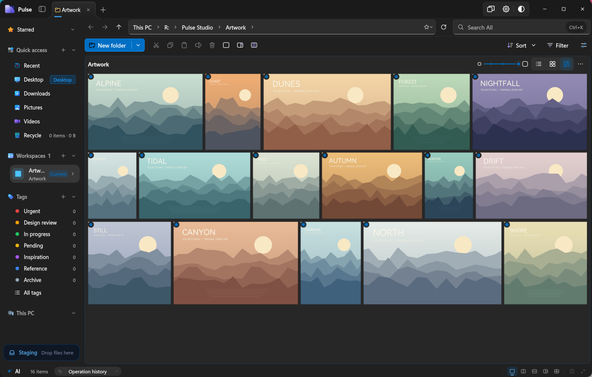
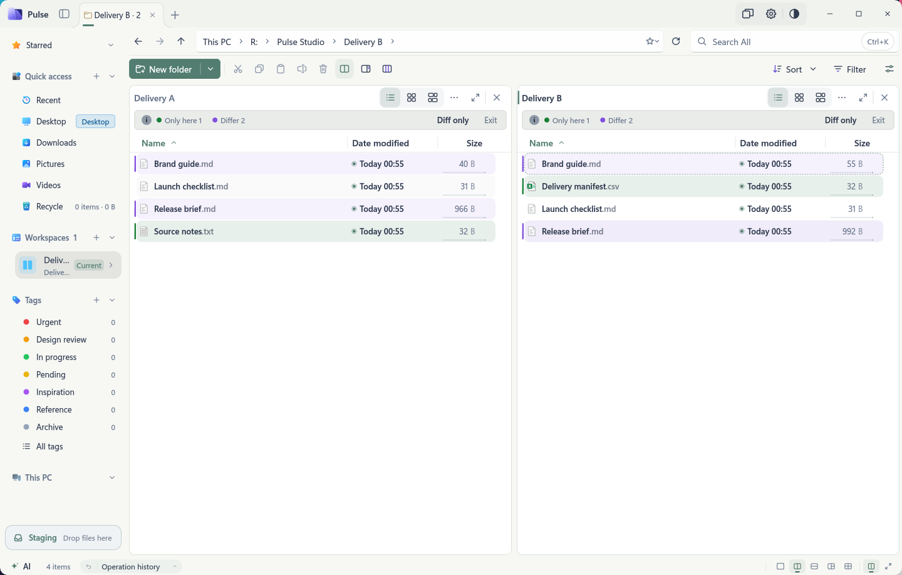
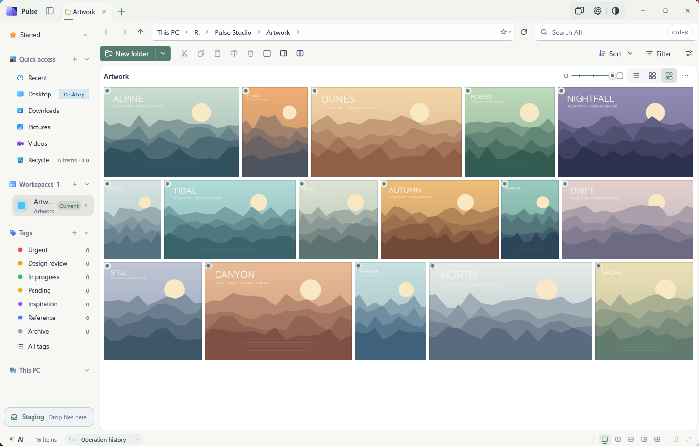
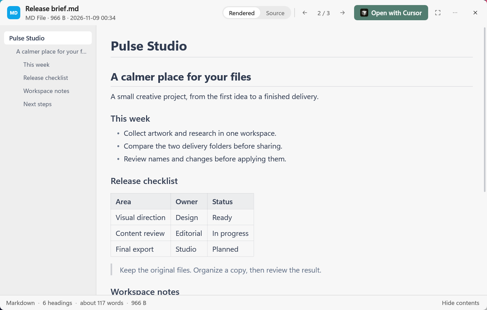
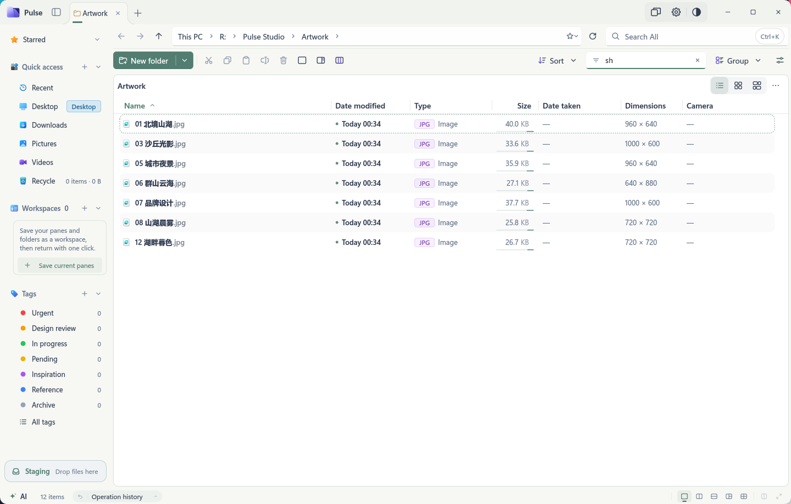
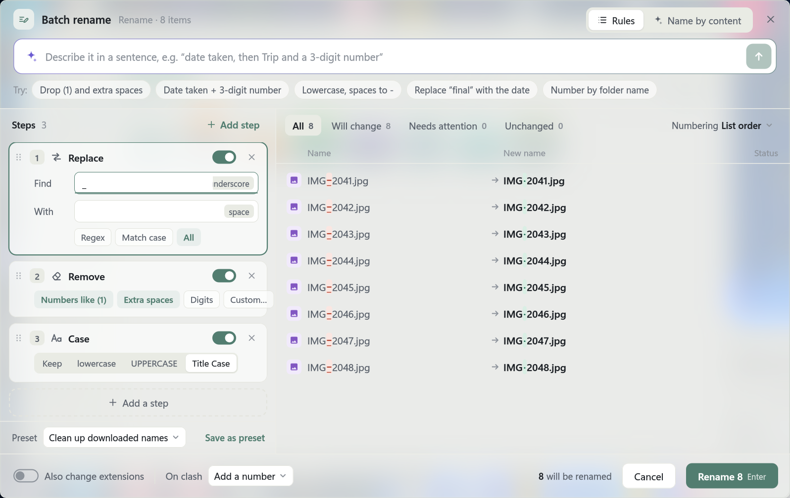
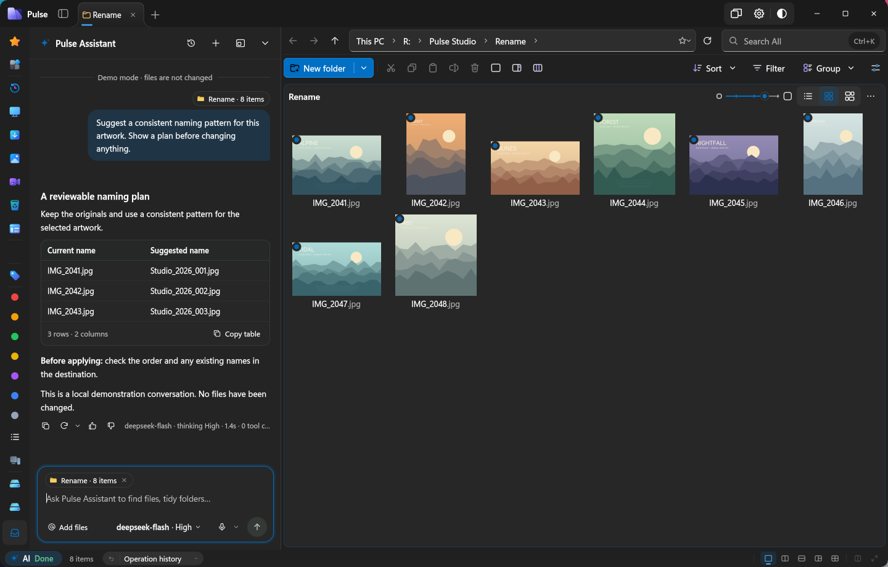

# Pulse


**不只是打开文件夹，而是把文件、素材和日常工作整理到一起。**

为 Windows 打造的文件管理器：多窗格与可恢复工作区、索引与拼音搜索、丰富预览、照片墙、标签与别名、可预览的批量重命名，以及先给方案、由你确认的 Pulse 助手。

[下载最新版](https://github.com/jimmgreen/pulse/releases/latest) · [1.0.59 更新说明](docs/releases/1.0.59.md) · [历史版本](https://github.com/jimmgreen/pulse/releases) · [反馈问题](https://github.com/jimmgreen/pulse/issues) · [English](README.en.md)

> 当前源码版本为 **1.0.59**，可下载版本以 Releases 为准。支持 Windows 10/11 x64，另提供 Windows 8.1 x64 兼容版。界面支持简体中文、繁體中文和 English。



## 把常用目录变成一张工作台

- **多窗格，不只是多开窗口**：左右、上下、三栏、四宫格与分栏浏览。每个标签页保留自己的目录组合和布局，窗格可以拖动换位。
- **保存工作区**：把「素材 → 项目 → 交付」保存成工作区，下次在当前或新标签页恢复。用名称、颜色和层级区分不同项目。
- **多个窗口也能一起安排**：Ctrl+N 新建窗口，窗口总览提供并排、平铺、主次、层叠与合并；排列后可以撤销。
- **工具栏按习惯摆放**：固定常用命令和程序，调整顺序、加入分隔线；支持自定义快捷键与右键菜单偏好。
- **视图随目录记忆**：详细信息、图标、列表、内容和照片墙，分别保留排序、分组与列设置。

### 交付前，看清两边哪里不同

双栏目录对比会标出仅在一侧、较新、较旧或不同的项目，也可只看差异，适合检查两份交付目录。



> 目录对比依据当前两栏条目的名称、时间和大小等元数据，不是递归内容校验，也不会自动同步文件。文本内容比较是另一项独立功能。

## 看素材，不必逐个打开应用

### 照片墙保留横竖比例

横图、竖图和视频按比例铺排，而不是全部裁成同样的方格。可调整显示大小，配合图片尺寸、拍摄时间、音乐或视频信息列查找素材。



### 空格预览，详情侧栏随选随看

- Markdown 排版、代码语法高亮、PDF 翻页、文件夹内容预览。
- CSV / TSV / XLSX 表格、JSON / XML 折叠树、Jupyter Notebook 单元格，以及 DOCX / EPUB 等文档。
- 图片、GIF / WebP / APNG 动画和视频播放；视频支持拖动进度、播放快捷键和点击画面暂停。
- 悬停预览卡片、可配置的鼠标长按临时预览，以及主窗口的详情侧栏，适合快速扫读而不打断当前工作。
- 内置 ZIP 预览；**7z/RAR 预览和解压需要另行安装、启用原生压缩包插件**，并非默认内置。



具体格式支持取决于增强包和系统组件，可在「设置 → 快速预览」查看。

## 找到之后，直接继续处理

- **整盘文件名搜索**：通过 PulseIndex 索引搜索，也可限定当前或指定文件夹。
- **拼音也能找**：全拼、首字母、多音字和命中高亮；在当前文件夹里输入 `sh`，也能筛出「品牌设计」「城市夜景」「山湖晨雾」等名称。
- **全文搜索**：按需安装内容搜索增强包，搜索文本、代码、PDF、Word、Excel、PowerPoint 等内容，结果流式加载。
- **全局快速搜索**：启用后按 Alt+Space 或连按两次 Ctrl 呼出，查找文件、常用目录和开始菜单应用；可预览、多选、复制和加入暂存盘。
- **接着在主窗口处理**：快速搜索中按 Shift+Enter，将关键词、范围和筛选一起带入主界面，不必重新搜索。
- **路径也能补全**：地址栏支持绝对路径、相对路径和别名导航；输入 `cmd`、`powershell`、`pwsh` 或 `wt` 在当前目录打开终端。



Ctrl+Shift+F 打开高级搜索；Ctrl+Shift+K 打开命令面板，记不住某个按钮的位置时，直接搜索命令。

## 给文件建立自己的组织方式

### 别名：名字好记，真实路径不变

按 Shift+F2 给文件或文件夹起别名，同时保留原名。项目代号、长路径可以显示为更容易记忆的名称；复制路径或拖给其他应用时仍使用真实路径，不破坏工程引用。地址栏还支持「别名\子目录」导航，别名可集中管理、导入和导出。

### 标签：从上色到跨目录资料集合

- 文件和文件夹都可打标签，按标签汇总分散在不同位置的资料。
- 用「必须有 / 任一 / 不含」组合条件，并保存为智能视图。
- 管理标签分组、合并重复标签、设置自动规则，以及导入或导出标签库。
- 文件搬走后，可重定位失效的标签引用；这不是恢复已删除的文件内容。

### 批量重命名：先看结果，再点执行

将查找替换、正则、清理、大小写、插入、编号和模板组合成步骤，实时对照原名与新名。照片可使用拍摄日期命名、按天编号；缺少拍摄日期时回退修改时间。

冲突可选择编号、跳过或阻止执行，常用方案保存为预设；完成后可撤销，失败项可单独重试。

也可以**用一句话生成规则**，或对支持的文本、PDF、Office 文档**按内容命名**。这需要配置模型服务及相应的文档读取能力；按内容命名会向所配置的模型发送提取的文本片段，请先检查敏感信息，再审阅生成的新名字。



### 暂存盘与文本差异

跨目录、跨标签页收集复制或剪切的文件，再一次拖到目标位置；默认复制，按住 Shift 为移动。暂存两个文件后，可比较大小、时间和内容，文本差异支持并排 / 统一视图、行内高亮和忽略空白或大小写。

文件操作提供进度、暂停和冲突处理，以及适用操作的撤销。重复文件查找和文件夹大小统计帮助清理资料，不必把所有操作交给助手。

## Pulse 助手：先给方案，由你确认

按 **Ctrl+J** 打开助手，自行配置 DeepSeek 等兼容服务或本地模型服务。

- 用自然语言查找文件、准备整理和批量重命名方案、查找重复文件、查看磁盘占用或调整设置。
- 重命名方案可先在列表中预览，选择确认、拒绝，或转入批量重命名继续调整；适用的已执行计划支持成组撤销。
- 对话历史支持搜索、重命名、置顶和保留期限；可编辑消息、重新生成回答和切换回答版本。
- 富文本回答、文字选择、语音输入，以及统一的服务、密钥、模型和思考等级设置；能力取决于具体模型和服务。



*演示对话*

模型服务的费用、可用性和数据处理规则由对应提供方决定。外部 MCP 客户端通过单独的 [AI 增强包](docs/ai-pack.md) 连接 Pulse，与内置助手、原生插件 SDK 是不同能力。

## 本机、项目仓库、NAS、手机与云盘

- **Git 就在文件列表旁**：查看分支、修改 / 新增 / 冲突状态和远端差距，并提供拉取与推送入口。需要安装 Git for Windows、让 `git` 可从 PATH 调用；这不是完整 Git 客户端。
- **网络共享**：发现局域网电脑和 NAS，通过 UNC、`smb://` 或 IP 连接 Windows 文件共享，可固定常用位置或映射盘符；不把 FTP / SFTP / WebDAV 当作 SMB 支持。
- **USB 手机**：浏览和复制已连接设备中的文件，在可写存储中新建目录；可见内容与可写范围取决于设备，不能保证 iPhone 或所有目录都可写。
- **云盘状态与按需下载**：在 OneDrive 等兼容的同步目录中查看在线 / 本地 / 固定状态，选择保留在设备上或释放空间；仅在线文件可显式下载后预览，普通浏览不会自动拉取整个目录。

## 让设置跟着工作走

浅色、深色或跟随系统，强调色、壁纸、透明度和适用系统上的窗口材质；还可调整列表行高、日期显示、斑马纹、扩展名标签与大小比例条。

**备份与迁移**可分类导出设置、快捷键与菜单偏好、快速访问 / 收藏 / 工作区、标签与规则、别名及保存的搜索。导入前提供备份与恢复入口；导入会替换所选类别的本机内容，并在重启后生效。

这不是整机备份：窗口位置、索引与缓存、开机启动及系统集成等机器相关内容不包含在内。

## Windows 集成与开发预览

### 可选的系统集成

可设为默认文件管理器，处理文件夹打开、Win+E 和「打开文件所在位置」，也可关闭相关集成。支持托盘启动、会话恢复，以及系统与应用程序右键菜单。

**打开 / 保存对话框接管仍为实验性功能**：在受支持的程序中使用 Pulse 的文件选择界面，不支持的场景保留原生界面，不保证兼容所有程序。

### Extensions / 原生插件 SDK（开发预览）

提供 **Windows x64、C++20 源码 SDK，当前为 SDK preview 3**，覆盖命令、界面、预览、后台任务、设置页与文件服务等接口。

- **尚非稳定 SDK / ABI 1.0**：接口和预览号仍可能变化，升级后可能需要重新编译插件。
- 本次提供 SDK 源码、示例与文档，不附带预编译插件包。示例需自行构建、准备依赖并显式安装、启用。
- **不是安全沙箱**：原生 DLL 与 Pulse 同进程、同系统权限运行。仅使用可信代码，签名或哈希校验不等于代码安全审查。
- 升级或回退已加载的插件后，需要重启 Pulse；旧 7-Zip 下载增强包不会自动转换为插件。

[文档入口](docs/extensions-index.md) · [SDK 接口与限制](sdk/native/README.md) · [快速开始](docs/extensions-sdk-quickstart.md) · [打包与签名](docs/native-packages.md)

## 下载、安装与更新

| 版本 | 适用系统 | 安装包 |
| --- | --- | --- |
| Windows 版 | Windows 10 / Windows 11 x64 | `PulseSetup-版本.exe` |
| Windows 8.1 兼容版 | Windows 8.1 x64 | `PulseSetup-版本-win81.exe` |

从 [Releases](https://github.com/jimmgreen/pulse/releases/latest) 下载安装包，按向导完成安装；可启用 PulseIndex 服务以使用全盘索引搜索。从 1.0.58 起不再提供新的便携 ZIP。部分预览、全文搜索和外部 AI 连接能力使用按需增强包。

Pulse 可在后台检查更新，或在「关于与诊断」中手动检查。**更新并重启**会下载、校验安装包，等待进行中的任务完成，保存会话后安装并恢复窗口；必要的 Windows 管理员确认仍需手动完成。下载与等待可取消，不会替你强行中断文件操作。

普通版与兼容版分别接收适用的更新，第三方加速源不绕过签名与文件校验。1.0.2 及更早版本需先手动安装较新的安装包。详见 [自动更新与发布](docs/automatic-updates.md)。

## 从源码构建

使用 Windows x64、Visual Studio C++ 工具、CMake 3.25+ 和 Ninja。在 **x64 Visual Studio 开发终端**的仓库根目录执行：

```powershell
cmake -S . -B build -G Ninja -DCMAKE_BUILD_TYPE=Release
cmake --build build --target pulse
.\build\pulse.exe
```

日常开发只构建受影响目标、运行相关测试，不必每次执行完整发行构建或全部历史测试。打包与发行检查另需 PowerShell 7.2+ 和 Python 3：

```powershell
pwsh ./scripts/build_release_ci.ps1 -Channel windows
pwsh ./scripts/build_release_ci.ps1 -Channel win81 -BuildDir build-ci-win81
```

发行脚本使用 Visual Studio 2022 v143，并校验仓库固定版本的 LumaText SDK；Windows 8.1 兼容构建不能用 VS 2026 工具链替代。开发时可通过 `LUMATEXT_SOURCE_DIR` 指定 LumaText 源码，未找到时使用 DirectWrite。

技术栈：C++20、Win32、Direct2D、DirectComposition；文件系统、索引、预览和 Shell 工作由后台任务与独立进程承担，减少界面阻塞。

## 文档与反馈

[更新说明](docs/releases/1.0.59.md) · [Windows 兼容性](docs/windows-compatibility.md) · [索引存储与迁移](docs/index-migration.md) · [AI 与 MCP](docs/ai-pack.md) · [原生扩展文档](docs/extensions-index.md) · [问题反馈](https://github.com/jimmgreen/pulse/issues)

反馈请附上 Pulse / Windows 版本、复现步骤及必要截图或诊断信息；分享前移除密钥和私人文件内容。

## 许可证

Pulse 源代码以 [Apache License 2.0](LICENSE) 授权。第三方组件遵循各自附带的许可证。
