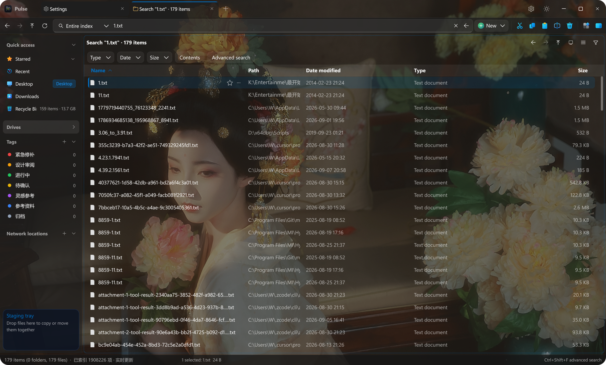
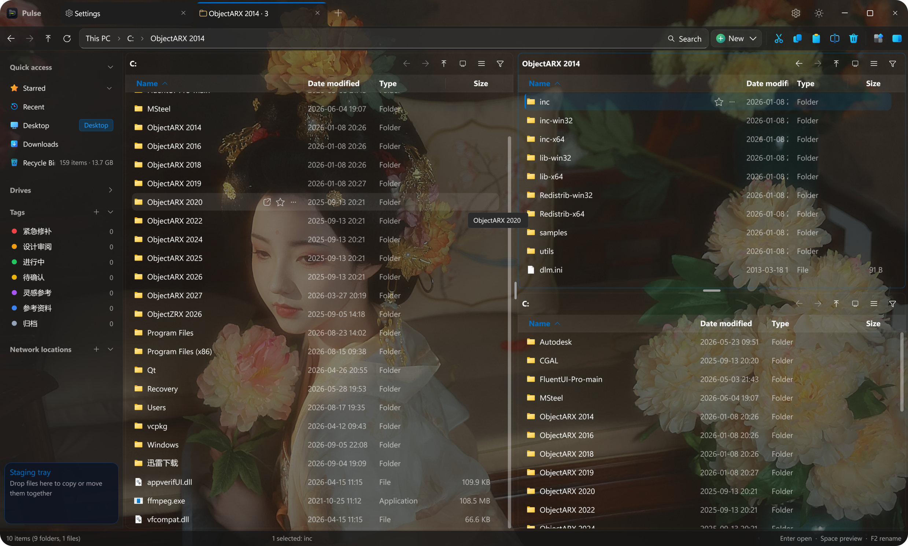

# Pulse

**为 Windows 打造的文件管理器，让浏览、搜索和整理文件更顺手。**

多标签与多窗格、全盘索引与拼音搜索、空格快速预览、暂存盘和可自定义外观，放在同一个工作空间里。

[下载最新版](https://github.com/jimmgreen/pulse/releases/latest) · [查看更新记录](https://github.com/jimmgreen/pulse/releases) · [反馈问题](https://github.com/jimmgreen/pulse/issues) · [English](README.en.md)


## 下载与安装

在发布页按系统选择安装包：

| 版本 | 适用系统 | 文件 |
| --- | --- | --- |
| Windows 版（64位） | Windows 10 / Windows 11 | `PulseSetup-版本.exe` |
| Windows 8.1 兼容版（64位） | Windows 8.1 | `PulseSetup-版本-win81.exe` |
| 免安装版（64位） | Windows 10 / Windows 11 | `Pulse-版本-portable-win-x64.zip` |

运行安装包，按向导完成安装。安装时可以启用 PulseIndex 服务，用于全盘索引搜索。免安装版解压即可运行，配置仍保存在用户应用数据目录；全盘索引服务需要通过安装版部署。

界面提供简体中文、繁體中文和 English，默认跟随 Windows，也可以在「设置 → 显示语言」中切换。

## 让工作空间适合你

- 浅色、深色或跟随系统主题，标题栏一键切换；可选主题色、窗口效果（亚克力、Mica）、壁纸背景、界面透明度与背景模糊。
- 文字渲染提供「自动 / 清晰 / 平滑」三种模式，列表行高可选紧凑、标准、宽松。
- 详细信息视图支持智能日期（「今天 14:32」「昨天 09:10」）、斑马纹行、彩色扩展名标签、大小比例条，列宽按内容自适应；右键列标题可选择显示哪些列。
- 七种颜色标签可以给文件和文件夹做标记，侧栏按标签汇总；也可以直接在资源管理器右键菜单中打标签。
- 侧栏分区可拖动排序、折叠，标签页可放到侧栏纵向排列（Ctrl+B 收起 / 展开）。

## 更快找到文件

- 通过 PulseIndex 索引搜索整盘文件名，结果实时更新；可以限定在当前文件夹或指定文件夹中搜索。
- 文件名搜索支持全拼、首字母和多音字，例如输入 `sh` 即可找到「品牌设计」「城市夜景」「山湖晨雾」，命中的文字会高亮。
- 内容搜索覆盖文本与代码、PDF、Word、Excel、PowerPoint 等格式，结果流式加载，打开所在位置后可后退回到原结果。
- 高级搜索（Ctrl+Shift+F）按类型、日期、大小等条件筛选；全局快速搜索（Alt+Space）随时呼出，也可以「在主界面搜索」查看全部结果。
- 地址栏输入 `cmd`、`powershell`、`pwsh` 或 `wt`，直接在当前文件夹打开终端。



## 多个目录，一起处理

- 单栏、左右分屏、上下分屏、三栏和四宫格布局（Ctrl+1/2/3/4），每个标签页保留自己的布局和位置。
- 分栏浏览同时展示上级、当前和选中的文件夹；平铺、图标、列表、详细信息和内容视图随时切换。
- 列表可按名称、日期、类型或大小分组，每个文件夹分别记住视图、排序和分组。
- 双栏文件夹对比标出两侧不同、缺失和较新的项目；后台统计文件夹大小。
- 详情面板显示预览、基本信息和标签；多选后可打开合并属性窗口。



## 空格快速预览

选中文件按空格即可预览，无需打开对应应用：

- Markdown 按排版显示，代码语法高亮，PDF 逐页翻看，文件夹显示内容列表。
- CSV / TSV / XLSX 以表格显示；JSON / XML 显示为可折叠的树，Jupyter Notebook 按单元格显示。
- DOCX、EPUB 和 Office 文档无需安装对应软件即可阅读；压缩包显示目录树并可在包内搜索。
- 视频可播放、拖动和逐帧，动态 WebP / APNG 可播放；另支持 SVG、PSD、AI、DWG 缩略图和字体等格式。

视频预览中，← / → 后退 / 前进 5 秒，按住 Shift 为 30 秒、Ctrl 为 60 秒；PageUp / PageDown 或 ↑ / ↓ 切换上一个 / 下一个文件。空格暂停 / 播放，逗号 / 句号保留逐帧操作。

EXE、DLL 等 PE 文件按属性与版本、PE 头与节区、DLL 依赖、导入、导出分标签显示，Ctrl+Tab 切换标签。依赖页显示静态搜索找到的候选路径，并区分缺失模块、下级依赖缺失和未能确认的情况。分析不会执行文件；API-set、运行时加载目录和 SxS 等情况不能仅凭磁盘搜索确定，结果不代表程序一定能启动。

指针在文件上停留片刻（默认 0.5 秒）会弹出悬停预览卡片，显示缩略图或文本摘录、类型和关键信息；卡片出现时按空格即展开为完整预览。卡片随内容变形：横图和视频更宽，文档页和竖图更高，没有预览的文件只显示信息；按住 Ctrl 可临时放大。「设置 → 快速预览 · 预览方式」可改为仅空格预览，或调整悬停延迟和卡片尺寸（小 / 中 / 大）。

「设置 → 快速预览 · 支持的格式」列出全部可预览格式，并检测 HEIF / HEVC / AV1 / WebP 系统扩展是否已安装。


## 暂存盘与文本对比

复制或剪切（Ctrl+C / Ctrl+X）的文件会收进左下角的暂存盘，可以跨文件夹、跨标签页收集后一次拖到目标位置；拖放默认复制，按住 Shift 为移动。

暂存两个文件时可以对照位置、修改时间、大小和内容；文本文件点击「查看差异」打开对比窗口，支持并排 / 统一视图、行内差异高亮、仅看差异、忽略空白和大小写，以及 F7 / Shift+F7 跳转。


## 融入 Windows

- 可以在设置中把 Pulse 设为默认文件管理器，用于打开文件夹、Win+E 和桌面上的「此电脑」；「打开文件所在位置」会在 Pulse 中选中文件。随时可以关闭，恢复原样。
- 右键菜单合并资源管理器与 Windows 11 新式菜单项（如 VS Code、Windows Terminal、NanaZip），Pulse 自带项可以隐藏。
- 支持开机启动到托盘、设置默认位置、启动时恢复上次的标签页。
- 文件被占用时显示占用进程，可以结束进程后重试；「此电脑」显示磁盘类型和容量条。


## 自动更新

Pulse 会在启动后自动检查新版。有更新时，窗口内会出现提示；点击提示即可下载安装包，校验通过后打开安装向导。也可以在「设置 → 关于与诊断」中手动检查更新；不想收到提醒时，在同一页关闭「自动检查更新」即可。

下载可以取消，安装时按 Windows 提示确认管理员权限。普通版和 Windows 8.1 兼容版分别获取适用的更新。

更新清单和安装包默认依次尝试 ghproxy.net、gh-proxy.com 加速源，连接失败后自动切换，最后回退到 GitHub，无需设置。所有来源均须通过签名和安装包校验。

**1.0.2 及更早版本需要先手动安装一次 1.0.3 或更新版本，之后即可收到自动更新提示。**

## 从源码构建

使用 Windows x64、Visual Studio C++ 工具、CMake 3.25+ 和 Ninja。发布构建另需 PowerShell 7.2+ 与 Python 3（打包安装程序）。

开发构建：

```powershell
.\build_release.bat
.\build\pulse.exe
```

生成与正式发布相同的安装包，并运行回归检查：

```powershell
pwsh ./scripts/build_release_ci.ps1 -Channel windows
pwsh ./scripts/build_release_ci.ps1 -Channel win81 -BuildDir build-ci-win81
```

发布脚本使用 Visual Studio 2022 v143，并校验仓库内固定版本的 LumaText 静态运行库 SDK。`cmake/lumatext-sdk.json` 固定 SDK 清单的 SHA-256，清单覆盖 DLL、导入库、头文件、CMake 导出和许可证。开发构建可通过 `LUMATEXT_SOURCE_DIR` 指定源码；未找到 LumaText 时使用 DirectWrite。

技术栈为 C++20、Win32、Direct2D 和 DirectComposition。文件系统、索引、预览与 Shell 任务分别放在对应模块，避免阻塞界面。

更多说明：[自动更新与发布](docs/automatic-updates.md) · [Windows 兼容性](docs/windows-compatibility.md) · [索引存储与迁移](docs/index-migration.md)

## 许可证

Pulse 源代码以 [Apache License 2.0](LICENSE) 授权。第三方组件（例如 LumaText SDK）遵循各自附带的许可证。
