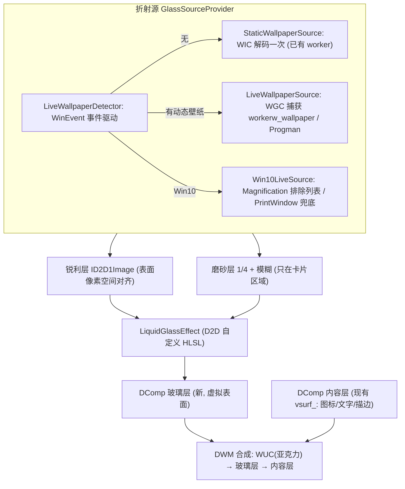

# 桌面整理：液态玻璃（Liquid Glass）材质实施方案

> 日期：2026-11-16（v2，已纳入需求决策）　范围：`extensions/desktop`（`pulse.desktop` 桌面整理插件）　状态：可执行
>
> 目标：给分组卡片、磁贴、菜单新增**真·液态玻璃**材质。要真折射，不能是“模糊加描边”。普通壁纸和**动态壁纸（Wallpaper Engine / Lively）都要真折射**。性能上守住插件现有底线。

## 需求决策记录

| # | 问题 | 决策 |
|---|---|---|
| Q1 | 材质形态 | **新增第 6 种材质** `CardMaterial::LiquidGlass = 5`，追加到枚举末尾、不改编号；默认材质仍是亚克力 |
| Q2 | 动态壁纸 | **必须支持真折射**，新增“实时壁纸源”（§5） |
| Q3 | 范围 | **纳入融合和菜单玻璃**（Phase 4） |
| Q4 | 旧版插件读到 `material = 5` 的降级行为 | 待定（§10）。建议：从本版起，读到未知值回退为亚克力 |

---

## 0. 一页结论

| 决策 | 结论 |
|---|---|
| 渲染 | **D2D 自定义效果**（`ID2D1EffectImpl` + `ID2D1DrawTransform` + 构建期 fxc 编译的 HLSL），画在新拆出的 **DComp 玻璃层**上（位于内容层之下） |
| 折射源 · 普通壁纸 | **壁纸快照**：复用 `WallpaperBackdrop` 已有的解码、定位和 DIP 映射。解码一次，之后不再有开销 |
| 折射源 · 动态壁纸 | **Windows.Graphics.Capture（WGC）按窗口捕获 Explorer 的壁纸宿主窗口**（经典模式是 `workerw_wallpaper`，24H2 是 `Progman`）。我们的层窗口是另一个顶层窗口，所以**不会采样到自己**；帧留在 GPU，零拷贝进入效果 |
| Win10 动态壁纸 | WGC 在 Win10 上强制显示黄框，不能用。改走 Magnification 排除列表方案，PrintWindow 兜底，由 Phase 0 判定能否放行（§5.6） |
| 着色器数学 | 移植 Kyant `AndroidLiquidGlass` 的圆角矩形 SDF、`circleMap` 高度剖面、色散和高光（Apache-2.0，需保留版权声明）；双瓣高光和 smooth-min 融合参考 `liquid-glass-studio`（MIT） |
| 明确不做 | Hook DWM 或 `wuceffectsi.dll`、注入、Desktop Duplication、`WDA_EXCLUDEFROMCAPTURE`（会让桌面整理从用户自己的截图里消失） |

为什么能做到“真”：层窗口是一个顶层工具窗口，始终紧贴在 Explorer 的桌面宿主之上（[desktop_mount.cpp#L1098-L1100](file:///c:/Users/SS/Desktop/pulse/extensions/desktop/host/desktop_mount.cpp#L1098-L1100)），所以卡片背后只有壁纸。静态壁纸用解码出来的像素，动态壁纸用捕获到的壁纸窗口像素。两种情况采样到的都是卡片背后真实存在的东西。

---

## 1. “正液态玻璃”的验收定义

| # | 特征 | 验收方式 |
|---|---|---|
| G1 | **边缘折射**：在边缘带（bezel）内，背景沿 SDF 法线位移，位移量按 `circleMap` 剖面从边缘最大单调衰减到 0 | 直线/棋盘格夹具截图：边缘带内直线弯曲，内部不弯曲 |
| G2 | **内外连续**：Clear 档（frost = 0）时，卡片内部直通真实壁纸；边缘带内外边界无接缝 | 内部像素与外部差值 ≤ 2/255；跨边界亮度梯度无突变 |
| G3 | **色散**（可开关）：边缘 R/B 通道错位 | 错位 ≥ 1 物理像素，内部为 0 |
| G4 | **镜面高光**：光源默认 −45°，双瓣高光并带菲涅耳衰减 | 左上边缘最亮，右下边缘次亮 |
| G5 | **几何对齐** | 100/125/150/200% DPI，6 种壁纸 fit 模式，误差 ≤ 1 物理像素 |
| G6 | **可读性** | 自适应 tint 后，正文对比度 ≥ 4.5:1 |
| G7 | **不是假玻璃** | frost = 0、tint = 0 时仍能看到折射和高光 |
| G8 | **动态壁纸真折射** | Wallpaper Engine 和 Lively 的视频/场景壁纸下，边缘带的折射内容随壁纸实时变化。折射源相对真实壁纸的延迟 ≤ 1 个刷新周期（默认 33 ms） |
| G9 | **液态感** | 按压有弹性、悬停时高光跟随指针、拖动卡片靠近时平滑融合（录屏评审） |
| G10 | **菜单玻璃** | 菜单折射的内容包含它背后的卡片和壁纸 |

---

## 2. 现状：材质管线（代码锚点）

- 材质枚举：[desktop_model.h#L76-L82](file:///c:/Users/SS/Desktop/pulse/extensions/desktop/host/model/desktop_model.h#L76-L82)。默认材质见 [L127-L133](file:///c:/Users/SS/Desktop/pulse/extensions/desktop/host/model/desktop_model.h#L127-L133)。
- 材质解析：[desktop_renderer.cpp#L1914-L1923](file:///c:/Users/SS/Desktop/pulse/extensions/desktop/host/render/desktop_renderer.cpp#L1914-L1923)。
- 卡片绘制：`DrawCardMaterial`，[desktop_renderer.cpp#L2281-L2400](file:///c:/Users/SS/Desktop/pulse/extensions/desktop/host/render/desktop_renderer.cpp#L2281-L2400)。现有三条路径：
  1. Mica：采样烘焙的 `SampledMicaBrush`；
  2. Win11 亚克力：同一 HWND 下层的 WUC 树 + `HostBackdropBrush`（[host_backdrop_layer.cpp](file:///c:/Users/SS/Desktop/pulse/extensions/desktop/host/render/host_backdrop_layer.cpp)）；
  3. Win10 / 离屏亚克力：1/4 分辨率预模糊的 `AcrylicBrush`。
- 壁纸源：[wallpaper_backdrop.h](file:///c:/Users/SS/Desktop/pulse/extensions/desktop/host/render/wallpaper_backdrop.h)。在 1/4 分辨率解码，保留 CPU 快照，提供 `SetDipMapping` 和 `AverageLuminance`。
- 桌面层级探测：[desktop_mount.h#L25-L44](file:///c:/Users/SS/Desktop/pulse/extensions/desktop/host/desktop_mount.h#L25-L44)。`DesktopHierarchyInfo` 已有 `ClassicWorkerW`、`Win11_24H2_ProgmanChild` 两种模式，以及 `workerw_wallpaper`、`explorer_pid`、`virtual_bounds`，**动态壁纸的检测和捕获目标直接复用这些字段**。
- 层窗口：`WS_EX_TOOLWINDOW | WS_EX_NOREDIRECTIONBITMAP` 的顶层 popup，覆盖主屏工作区，由 `PlaceAboveHost` 维持 Z 序（[desktop_mount.cpp#L1130-L1192](file:///c:/Users/SS/Desktop/pulse/extensions/desktop/host/desktop_mount.cpp#L1130-L1192)）。
- 前景是单个 DComp 虚拟表面 `vsurf_`，按脏矩形绘制，空闲时 0 Present。
- 材质 UI 入口：
  - 设置页 [settings_page.cpp#L348-L349](file:///c:/Users/SS/Desktop/pulse/extensions/desktop/plugin/settings_page.cpp#L348-L349)，上限 `4` 出现在 L100、L147、L534、L670；
  - 分组菜单 [desktop_overlays.cpp#L1285-L1298](file:///c:/Users/SS/Desktop/pulse/extensions/desktop/host/overlays/desktop_overlays.cpp#L1285-L1298)，磁贴菜单在 L1503 附近，美化面板在 [L3150-L3155](file:///c:/Users/SS/Desktop/pulse/extensions/desktop/host/overlays/desktop_overlays.cpp#L3150-L3155)；
  - 命令解析 [host_main.cpp#L3466-L3470](file:///c:/Users/SS/Desktop/pulse/extensions/desktop/host/host_main.cpp#L3466-L3470) 和 [L3550-L3552](file:///c:/Users/SS/Desktop/pulse/extensions/desktop/host/host_main.cpp#L3550-L3552)。
- 约束和测试：`--benchmark-4k` 要求 **< 25 MB** 且空闲 0 Present；`--render-snapshots` 离屏导出；现有测试目标 `pulse_desktop_material_live_test`、`pulse_desktop_mica_graph_test`。仓库中目前**没有**自定义 D2D 效果或 HLSL，需要新建 fxc 构建规则。

---

## 3. 开源调研

| 项目 | 许可证 | 技术路线 | 借鉴点 | 能否直接用 |
|---|---|---|---|---|
| [Kyant0/AndroidLiquidGlass](https://github.com/Kyant0/AndroidLiquidGlass) ★4.6k | Apache-2.0 | AGSL：圆角矩形 SDF + 梯度法线 + `circleMap` + 6 段色散 + 高光 | **核心数学**；内部 `-sd ≥ refractionHeight` 时直接返回原像素，这是“内部直通”的依据 | 移植算法，保留版权声明 |
| [iyinchao/liquid-glass-studio](https://github.com/iyinchao/liquid-glass-studio) ★830 | MIT | WebGL2/WebGPU：superellipse、smooth-min 融合、菲涅耳、双瓣 glare | 高光和融合（Phase 3/4） | 参考算法 |
| [rdev/liquid-glass-react](https://github.com/rdev/liquid-glass-react) ★6.7k / [shuding/liquid-glass](https://github.com/shuding/liquid-glass) | MIT | SVG `feDisplacementMap`，预生成位移图 | Plan B：D2D 内置 `DisplacementMap` | 参考 |
| [whynotmake-it/flutter_liquid_glass](https://github.com/whynotmake-it/flutter_liquid_glass) | Apache-2.0 | 多形状融合 shader | 融合参数化 | 参考 |
| [niss1m/liquidock](https://github.com/niss1m/liquidock) | **BSL 1.1** | C++/D3D11/DComp Dock；壁纸模式解码一次；实时模式用 **Magnification 排除列表**（为了避开 Desktop Duplication 采样到自己），30 Hz 心跳，1 秒无变化后降到 6 Hz | 双源设计、Win10 实时方案、限速策略、TDR 后重建 | **只参考 README 中的设计，不看不抄源码** |
| [dilmurod…/liquidglass](https://github.com/dilmurod3037729-max/liquidglass) | MIT | D3D11 + **WGC 按窗口捕获**，“the glass never sees itself”；只按 dirty 区重绘；按窗口限速；README 注明 Win10 可能出现黄框 | **证明按窗口 WGC 没有自反馈**；限速和脏区；Win10 黄框风险 | 参考 |
| [alphamerics/liquid-glass](https://github.com/alphamerics/liquid-glass) | MIT | D3D11 + WGC + 会话级 broker，dual-Kawase 模糊 | 共享背景源、Kawase 模糊 | 参考 |
| [luckyelysia/LiquidGlassWinUI](https://github.com/luckyelysia/LiquidGlassWinUI)、[WinUI.Composition.Hlsl](https://github.com/Millennium-Science-Technology-R-D-Inst/WinUI.Composition.Hlsl) | MIT | 通过 IAT hook 或私有 ABI 把 HLSL 注入 Composition | HLSL 结构和参数命名 | **排除** |
| [JamesLinYJ/LiquidGlassWinUI3](https://github.com/JamesLinYJ/LiquidGlassWinUI3) | MIT | 只用公开 Composition API | 作者写明“does not perform per-pixel HLSL displacement”，`RefractionAmount` 只是占位 | 反证：HostBackdrop 这条路做不了真折射 |

**结论**

1. 公开 Composition API 不能对 `HostBackdropBrush` 做位移，现有亚克力路径无法升级。
2. 注入式方案不稳定，排除。
3. 静态壁纸不需要捕获。动态壁纸用**按窗口 WGC 捕获 Explorer 壁纸宿主**最干净：我们的层窗口不在被捕获窗口的子树里，天然没有反馈环；也不必像 liquidock 那样依赖 Magnification。Magnification 只作为 Win10 的备选。

---

## 4. 总体架构



**玻璃层拆分（新增，属于基础改动）**：现在只有一个 `vsurf_`，动态壁纸每更新一帧都得重绘图标和文字。拆成两层后：

- 玻璃层：新的 `IDCompositionVirtualSurface`，放在内容层下面，只画玻璃和外阴影；
- 内容层：现有 `vsurf_`，玻璃卡片区域只画 tint、描边和内容。

实时帧、悬停光源变化只重绘玻璃层的脏矩形，内容层保持 0 重绘。

### 4.1 新增和修改的文件

| 文件 | 改动 |
|---|---|
| `host/render/liquid_glass_effect.h/.cpp`（新） | 自定义效果注册、`ID2D1DrawTransform`、属性绑定 |
| `host/render/shaders/liquid_glass.hlsl`（新） | 像素着色器；fxc 生成 `liquid_glass_ps.h` |
| `host/render/liquid_glass_params.h`（新） | 纯数据 `GlassParams` 和 `MakeGlassParams(...)`，便于单测 |
| `host/render/glass_source.h/.cpp`（新） | `IGlassSource` 接口：`Sharp()`、`Frost()`、`ToSurfaceTransform()`、`Generation()`；实现 `StaticWallpaperSource`（包装 `WallpaperBackdrop`） |
| `host/render/live_wallpaper_source.h/.cpp`（新） | WGC 捕获、限速、帧到达后投递消息 |
| `host/render/win10_live_source.h/.cpp`（新，以 Phase 0 结论为准） | Magnification / PrintWindow |
| `host/live_wallpaper_detector.h/.cpp`（新） | 基于 `DesktopHierarchyInfo` 的检测，加 `SetWinEventHook`（out-of-context）；判定逻辑是纯函数，可以单测 |
| `desktop_renderer.h/.cpp` | 玻璃层 DComp visual 和 surface；`DrawCardMaterial` 新增 LiquidGlass 分支；分层脏矩形；释放和重建设备资源 |
| `wallpaper_backdrop.h/.cpp` | `EnsureGlassSource` / `ReleaseGlassSource`；计入 `MaterialStats()` |
| `desktop_model.h` | `CardMaterial::LiquidGlass = 5`；`BeautifySettings` 新增 `glass_dispersion`（0 关 / 1 弱 / 2 强）和 `glass_live_rate`（0 省电 15 fps / 1 标准 30 fps / 2 流畅 60 fps） |
| `host_main.cpp` | `mat-liquid`、`"liquid-glass"`、`b-mat:5` 及新设置项的解析和持久化；检测器生命周期；`WM_APP_GLASS_FRAME` 消息处理 |
| `desktop_overlays.cpp`、`desktop_shared_menu.cpp` | 三处材质入口；菜单玻璃（Phase 4） |
| `plugin/settings_page.cpp` | 材质分段新增「液态玻璃」，上限改为 5；新增“色散”和“动态壁纸刷新率”两项（仅在选中液态玻璃时显示） |
| `CMakeLists.txt` | fxc 规则；链接 `windowsapp`（WGC，C++/WinRT 已在 `host_backdrop_layer.cpp` 中使用）和 `magnification`（延迟加载）；新增测试目标 |
| 界面文字 | 跟随插件现有机制。如果进入 `tools/l10n/catalog.tsv`，只改 catalog 并运行 `python tools/l10n/gen_strings.py` |

---

## 5. 折射源

### 5.1 静态壁纸源（StaticWallpaperSource）

- **锐利层**：分辨率由 Phase 0 实测 4K 内存余量决定。余量 ≥ 10 MB 用 1/2 分辨率（4K ≈ 8.3 MB，1080p ≈ 2.1 MB），否则用 1/3 分辨率（4K ≈ 3.7 MB）。
- **磨砂层**：1/4 分辨率加预模糊（4K ≈ 2 MB）。σ 合适时优先复用已有的 `acrylic_blur_`。
- 懒创建；材质切走后 5 s 释放；收到 `WM_SETTINGCHANGE`（已有处理）时重建。
- Clear 档内部直通：内部输出 alpha = 0，透出 Explorer 绘制的全分辨率真实壁纸，只有边缘带使用纹理。

### 5.2 动态壁纸检测（LiveWallpaperDetector）

判定是一个纯函数：输入 `DesktopHierarchyInfo` 和候选窗口列表 `{hwnd, pid, visible, cloaked, rect}`，输出 `{live, capture_target, wallpaper_pid}`。

| 层级模式 | 动态壁纸窗口所在位置 | 捕获目标（顶层窗口） |
|---|---|---|
| `ClassicWorkerW` | `workerw_wallpaper` 的子窗口 | `workerw_wallpaper` |
| `Win11_24H2_ProgmanChild` | `Progman` 下 WorkerW 的子窗口 | `Progman` |
| `FallbackProgman` | `Progman` 的子窗口 | `Progman` |

- **判定规则**：上述父窗口下存在一个**可见、未 cloak、面积 ≥ 主屏工作区 50%、所属进程 ≠ `explorer_pid`** 的子窗口，就认为有动态壁纸。不硬编码 Wallpaper Engine 或 Lively 的类名，进程名只写日志。
  - 只看 `workerw_wallpaper` 是否存在不可靠，系统幻灯片过渡也会生成它，必须同时满足“非 Explorer 进程的子窗口”。
- **触发方式（事件驱动，空闲时为 0）**：
  - `SetWinEventHook(EVENT_OBJECT_SHOW / HIDE / DESTROY / EVENT_OBJECT_PARENTCHANGE, WINEVENT_OUTOFCONTEXT)`，回调里只检查目标父窗口下的子窗口变化；
  - 另外在 `TaskbarCreated`、重新挂载、`PlaceAboveHost` 重新探测层级时复判一次。
  - 不轮询，不注入。
- 判定发生变化时，切换折射源，并让玻璃层整层失效重绘一次。

### 5.3 动态壁纸实时源（LiveWallpaperSource，Win11）

**捕获**

- `IGraphicsCaptureItemInterop::CreateForWindow(capture_target)`。
- `Direct3D11CaptureFramePool::CreateFreeThreaded(device, B8G8R8A8UIntNormalized, numberOfBuffers = 1, size)`，复用渲染器自己的 D3D11 设备，通过 `CreateDirect3D11DeviceFromDXGIDevice` 包装。
- 会话设置：
  - `IsCursorCaptureEnabled(false)`；
  - `IsBorderRequired(false)`，事先调用 `GraphicsCaptureAccess::RequestAccessAsync(Borderless)`；
  - 26100+ 上额外设置 `MinUpdateInterval`（等于刷新周期）和 `DirtyRegionMode::ReportOnly`。

**为什么没有自反馈**：捕获目标是 Explorer 的壁纸宿主窗口，我们的层窗口是独立的顶层窗口，不在它的子树中。按窗口捕获不受遮挡影响，所以层窗口盖在上面也不影响捕获结果。

**帧处理（UI 线程不阻塞）**

1. `FrameArrived` 在线程池上触发，只做一件事：用原子标志合并，然后 `PostMessage(hwnd, WM_APP_GLASS_FRAME)`。
2. UI 线程按刷新周期（15/30/60 fps）处理消息：`TryGetNextFrame()` 取最新帧（只保留最新的）→ `CreateBitmapFromDxgiSurface` **零拷贝**包装成 `ID2D1Bitmap1` → 锐利层直接引用这张位图 → `EndDraw` 后立即 `Close()` 帧，归还缓冲。
3. 坐标：帧坐标 = 屏幕坐标 − 捕获目标的 `DWMWA_EXTENDED_FRAME_BOUNDS` 原点；再用和静态源相同的 surface 映射对齐。
4. **磨砂层**：只对“玻璃卡片矩形 ∪ 位移外扩”做 Crop → 1/4 缩放 → GaussianBlur（D2D 内置效果，中间面由 D2D 池化），不对整帧模糊。
5. **脏区裁剪**：26100+ 用 `DirtyRegions` 与卡片外扩矩形求交，没有交集就跳过该帧（只归还，不绘制）。更早的版本依靠刷新周期限速。
6. 只把玻璃层上卡片的外扩矩形标记为脏，内容层不动。

**暂停（这时开销为 0）**

- 没有可见的玻璃卡片（材质不是液态玻璃、图标已隐藏、演示场景）；
- 现有 `ShouldPauseLiveActivity`（全屏应用、电池）判定为真；
- 锁屏或显示器关闭（`WM_WTSSESSION_CHANGE`、`GUID_CONSOLE_DISPLAY_STATE`）；
- 壁纸程序自己暂停时不再产生新帧，开销自然归零。

暂停期间**保留最后一帧作为静态源**（折射仍然正确，只是不动），不回退成亚克力。完全停止 30 s 后才释放帧池。

**生命周期**

- 捕获目标销毁或层级重新探测时，重建捕获项；`ContentSize` 变化时调用 `Recreate`。
- 设备丢失时与渲染器一起重建（复用现有 `D2DERR_RECREATE_TARGET` 分支）。
- 多 GPU：壁纸程序和我们不在同一块显卡时，跨显卡拷贝由 WGC 负责，日志记录适配器 LUID 便于排查。

**隐私**

- 只捕获 Explorer 的壁纸宿主窗口，从不捕获其他应用窗口。
- 像素只停留在 GPU：不回读到 CPU、不落盘、不写日志。
- 设置项说明：“实时折射动态壁纸：仅读取壁纸画面，不读取其他应用窗口”。
- 系统隐私设置拒绝图形捕获时，回退到最后一帧或静态源，并给出提示。

### 5.4 内存与延迟

| 项 | 开销 |
|---|---|
| 帧池 1 个缓冲 | 捕获目标尺寸 × 4 B：1080p 单屏 8.3 MB，4K 单屏 33 MB；多屏时 `Progman`/WorkerW 横跨虚拟屏幕，按总面积计算 |
| 锐利层 | 0（直接引用帧，零拷贝） |
| 磨砂层中间面 | ≤ 4 MB（只覆盖卡片区域的 1/4 分辨率） |
| 折射延迟 | ≤ 1 个刷新周期。Clear 档内部直通，由 DWM 实时合成，**0 延迟**；只有边缘带有 ≤ 33 ms 延迟，并通过内边界羽化隐藏 |

> [!IMPORTANT]
> 实时模式的帧池是**新增的 GPU 内存**，只在“检测到动态壁纸、使用液态玻璃、并且有可见玻璃卡片”时存在。它单独设预算，不计入现有 `--benchmark-4k` 的 25 MB（那是静态模式的断言，继续保留）。多屏 4K 的帧池较大，Phase 0 要实测：如果超过 64 MB，先评估多屏下只捕获主屏对应的壁纸子窗口是否可行（取决于 WGC 能否捕获子窗口），不行就在设置页明示占用。

### 5.5 Win10 动态壁纸（19041–19045）

Win10 上 WGC 的 `IsBorderRequired` 不可用，会在壁纸周围画出黄框，所以**不能使用**。按以下顺序做 Phase 0 判定：

1. **Magnification 排除列表**：放在隐藏宿主窗口里的放大镜控件，`MagSetWindowSource(主屏工作区)` + `MagSetWindowFilterList(MW_FILTERMODE_EXCLUDE, {层窗口, 菜单窗口})`。读取方式按 liquidock 公开 README 描述的思路自行实现并验证，帧率按刷新周期，加采样校验和去重。
2. **PrintWindow 兜底**：`PrintWindow(capture_target, PW_RENDERFULLCONTENT)` 到 DIB，只取主屏工作区，≤ 10 fps，上传后只更新卡片区域。
3. 判定标准：两者中**至少一个**在 Win10 22H2 + Wallpaper Engine/Lively 上画面正确（不黑屏、不采样到自己），并且 CPU ≤ 5% 单核（30 fps 或 10 fps）。
   - 都不满足：Win10 动态壁纸降级为“最后一帧冻结折射”（每 2 s 用 PrintWindow 刷新一次），并**向你报告，等待确认**，不擅自降级。

### 5.6 源选择

| 环境 | 源 |
|---|---|
| 无动态壁纸 | StaticWallpaperSource |
| 动态壁纸 + Win11（22000+） | LiveWallpaperSource（WGC） |
| 动态壁纸 + Win10 | Win10LiveSource（以 Phase 0 结论为准） |
| 动态壁纸 + 实时源失败（隐私拒绝、捕获失败） | 最后一帧，否则静态壁纸文件（可能与画面不符），日志记录并在设置页提示 |
| 远程桌面 | 静态源；实时源不启用 |

---

## 6. 渲染：LiquidGlassEffect

### 6.1 D2D 自定义效果要点

- 注册：`ID2D1Factory1::RegisterEffectFromString(CLSID_PulseLiquidGlass, xml, bindings, n, Factory)`，每个 factory 一次；设备丢失后只需重建实例。
- 两个输入都是 complex 输入（要做偏移采样），按 full shader 编译：
  `fxc /T ps_4_0 /E main /O3 /D D2D_FULL_SHADER /D D2D_ENTRY=main /I "<WindowsSdk>\Include\<ver>\um" /Fh liquid_glass_ps.h /Vn g_liquid_glass_ps liquid_glass.hlsl`
- `ID2D1DrawTransform`：
  - `MapOutputRectToInputRects`：输入矩形 = 输出外扩 `ceil(|refraction|·(1+dispersion)) + 2`；
  - `MapInputRectsToOutputRect`：输出 = 卡片矩形（属性）；
  - `MapInvalidRect`：同样外扩；
  - `SetDrawInfo`：线性过滤。
- 坐标：输入先经过 `CLSID_D2D12DAffineTransform` 对齐到表面像素空间（由 `IGlassSource::ToSurfaceTransform()` 提供）；着色器内用 `D2DGetScenePosition()` 和 `D2DSampleInputAtOffset()` 采样。
- 实例策略（Phase 0 验证）：同一个 `BeginDraw` 内对同一实例改属性是否安全。不安全就用按卡片 id 索引的实例池（LRU，上限 32）。

### 6.2 着色器（参考实现，最终版本在 Phase 0 定稿）

```hlsl
// liquid_glass.hlsl — 圆角矩形 SDF 与折射剖面移植自 Kyant/AndroidLiquidGlass (Apache-2.0)
#define D2D_INPUT_COUNT 2            // 0 = 锐利层, 1 = 磨砂层（均已对齐到表面像素空间）
#define D2D_INPUT0_COMPLEX
#define D2D_INPUT1_COMPLEX
#define D2D_REQUIRES_SCENE_POSITION
#include "d2d1effecthelpers.hlsli"

cbuffer Constants : register(b0) {
    float2 rect_origin;  float2 rect_size;     // 卡片，表面像素
    float  radius;       float  bezel;         // 圆角、折射带宽 (px)
    float  refraction;   float  depth;         // 最大位移 (px, 负值=向内取样)、中心法线偏置
    float  dispersion;   float  frost;         // 0..1
    float2 light_dir;    float  spec;          // 光源方向、高光强度
    float  clear_interior; float vibrance;     // 内部直通、饱和度增益
    float  feather;      float3 _pad;          // 内边界羽化宽度 (px)，掩盖实时源的 1 帧延迟
};

float SdRoundRect(float2 p, float2 h, float r) {
    float2 q = abs(p) - (h - r);
    return length(max(q, 0.0)) - r + min(max(q.x, q.y), 0.0);
}
float2 GradRoundRect(float2 p, float2 h, float r) {
    float2 q = abs(p) - (h - r);
    if (q.x >= 0.0 || q.y >= 0.0) return sign(p) * normalize(max(q, 1e-4));
    float gx = step(q.y, q.x);
    return sign(p) * float2(gx, 1.0 - gx);
}
float CircleMap(float x) { return 1.0 - sqrt(saturate(1.0 - x * x)); }
float4 Sample(float2 off) {
    return lerp(D2DSampleInputAtOffset(0, off), D2DSampleInputAtOffset(1, off), frost);
}

D2D_PS_ENTRY(main) {
    float2 h = rect_size * 0.5;
    float2 c = D2DGetScenePosition().xy - (rect_origin + h);
    float sd = SdRoundRect(c, h, radius);
    float cov = saturate(0.5 - sd);                        // 1px 抗锯齿
    if (cov <= 0.0) return 0;
    float inner = -sd;
    if (inner >= bezel) {                                  // 平坦内部
        if (clear_interior > 0.5) return 0;                // 直通真实壁纸（实时源下由 DWM 实时合成）
        return Sample(0) * cov;
    }
    float d = CircleMap(1.0 - inner / bezel) * refraction;
    float gr = min(radius * 1.5, min(h.x, h.y));
    float2 n = normalize(GradRoundRect(c, h, gr) + depth * normalize(c + 1e-4));
    float2 off = d * n;
    float4 col;
    if (dispersion > 0.0) {
        float2 k = off * dispersion * 0.35;
        col = float4(Sample(off + k).r, Sample(off).g, Sample(off - k).b, 1);
    } else {
        col = Sample(off);
    }
    float edge = 1.0 - saturate(inner / bezel);
    float ndl = dot(n, -light_dir);
    float lobe = pow(saturate(ndl), 3.0) + 0.45 * pow(saturate(-ndl), 3.0);
    col.rgb += spec * lobe * edge * edge;                  // 菲涅耳 + 双瓣高光
    float l = dot(col.rgb, float3(0.2126, 0.7152, 0.0722));
    col.rgb = lerp(l.xxx, col.rgb, 1.0 + vibrance);
    float a = cov;
    if (clear_interior > 0.5)                              // 向内边界羽化，与直通区域平滑衔接
        a *= saturate((bezel - inner) / max(feather, 1.0));
    return float4(saturate(col.rgb), 1.0) * a;             // 预乘 alpha
}
```

采样次数：内部 0–2 次，边缘 2 次（无色散）或 6 次（有色散）。frost 为 0 或 1 时由常量分支跳过其中一层。

### 6.3 绘制顺序

- 玻璃层：外阴影（强度约 0.6 倍）→ `DrawImage(LiquidGlassEffect)`。
- 内容层：
  1. 自适应 tint（`CardSurfaceProfile` 加局部平均亮度：静态源用 `AverageLuminance()`；实时源复用磨砂层，在 1/4 分辨率上低频估算，每秒最多更新 2 次，避免文字颜色闪烁）；
  2. 1 px 内高光描边（复用 `border_grad_brush_`，不透明度 +30%）；
  3. 图标和文字。不叠 noise grain。

### 6.4 参数映射（默认值，DIP）

| 参数 | 默认 |
|---|---|
| `bezel` | `clamp(min(w,h)*0.18, 10, 24)`，并且 ≤ `h/2 - 1`（折叠后的分组会自动变窄） |
| `refraction` | `-0.9 × bezel` |
| `depth` | 0.15 |
| `dispersion` | 设置项：关 0 / 弱 0.2 / 强 0.35，默认“弱” |
| `frost` | “界面透明度”滑杆：100% → 0（Clear），30% → 1（Regular），中间线性 |
| `light_dir` / `spec` | (−0.707, −0.707)；深色 0.35 / 浅色 0.22 |
| `vibrance` | 0.15（只在 frost > 0 时生效） |
| `feather` | 静态源 2 px；实时源 6 px |

---

## 7. 性能预算

| 指标 | 静态源 | 实时源（动态壁纸） | 测量方法 |
|---|---|---|---|
| 空闲（壁纸不动或已暂停） | **0 Present / 0 GPU / 0 唤醒** | **0 Present**（没有新帧就没有工作） | `--benchmark-4k`；`stats.dirty_presents` |
| 4K 进程内存 | < 25 MB（现有断言），玻璃增量 ≤ 10.5 MB | 静态部分不变，另加帧池（§5.4，单独预算） | `--benchmark-4k` 液态玻璃变体；`MaterialStats()` 计入 glass/capture 字节 |
| 每次刷新 GPU 增量 | 交互帧：4K、12 张卡片，在 iGPU（UHD 620 级别）上 ≤ 1.0 ms | 每帧 ≤ 1.5 ms（含裁剪区模糊） | 只在 bench 模式开启 D3D11 timestamp query；或 WPR/GPUView |
| UI 线程 CPU | 首次构建 ≤ 16 ms | 每帧 ≤ 1 ms；30 fps 下总计 ≤ 3% 单核 | QPC 打点；ETW |
| 内容层重绘 | 只在交互时 | **0**（实时帧只重绘玻璃层） | 分层的 Present 计数 |
| 帧率 | 拖动和悬停 60 fps | 跟随设置 15/30/60 fps，不拖慢壁纸程序 | PresentMon（我们和壁纸程序都要测） |
| TDR / 设备丢失 | 自动重建 | 帧池随设备重建 | 手动触发驱动重置 |

---

## 8. 实施阶段

> 每个阶段只构建受影响的目标、只运行相关测试（遵循 AGENTS）。

### Phase 0：技术验证 spike（2 天）

产出：`liquid_glass_effect.*`、`liquid_glass.hlsl`、fxc 规则、`live_wallpaper_source` 原型，以及测试目标 `pulse_desktop_liquid_glass_test`。

| 编号 | 必须回答的问题 | 不通过时 |
|---|---|---|
| P0-1 | 自定义效果能否在 `vsurf_` 和离屏路径中注册并绘制 | 改走 Plan B：内置 `DisplacementMap` + 预计算位移图 |
| P0-2 | 同一 `BeginDraw` 内对同一实例改属性是否安全 | 用实例池 |
| P0-3 | 100/150% DPI 下坐标对齐 ≤ 1 px | 修正映射 |
| P0-4 | 4K 内存基线，决定静态锐利层用 1/2 还是 1/3 分辨率 | — |
| P0-5 | **WGC 能否捕获 `workerw_wallpaper`（经典模式）和 `Progman`（24H2）并拿到壁纸画面**（Wallpaper Engine 视频和场景、Lively 网页和视频壁纸）；无边框能否在未打包应用中生效；能否直接捕获子窗口（决定多屏帧池大小） | 换捕获目标，或评估 Magnification |
| P0-6 | Win10 22H2 上 Magnification 和 PrintWindow 的可行性及 CPU 开销（§5.5） | 向你汇报，等待决策 |
| P0-7 | GPU 耗时粗测是否满足 §7 | 调整采样次数和分辨率 |

```powershell
cmake --build build --target pulse_desktop_liquid_glass_test
.\build\pulse_desktop_liquid_glass_test.exe
```

### Phase 1：静态液态玻璃材质（4 天）

1. 模型、持久化、三处菜单和设置页入口（上限改为 5，新增“色散”设置项）。
2. `IGlassSource` 加 `StaticWallpaperSource`；`DrawCardMaterial` 分支；参数映射；自适应 tint；回退矩阵（透明效果关闭或高对比度 → 纯色；效果不可用或 D3D 功能级别低于 10_0 → 亚克力）。
3. 测试：
   - `pulse_desktop_liquid_glass_test`：G1–G4 像素断言，`MakeGlassParams` 边界（窄卡片、折叠 header、0%/100% 透明度），懒创建和释放后内存回落；
   - `pulse_desktop_settings_test`：`material = 5` 和新设置项的往返读写；
   - `--benchmark-4k` 液态玻璃变体：< 25 MB，空闲 0 Present。
4. 人工检查：深色/浅色；100/125/150/200% DPI；6 种壁纸 fit 模式；幻灯片切换；亮、暗、纯色壁纸；Win10 和 Win11 各一台。

### Phase 2：玻璃层拆分 + 动态壁纸实时折射（5 天）

1. 玻璃层 DComp visual 和 surface，分层脏矩形；已有材质的视觉结果不变（回归截图对比）。
2. `LiveWallpaperDetector`（纯函数加 WinEvent）和 `LiveWallpaperSource`（WGC）；Win10 源按 P0-6 的结论实现。
3. 限速、脏区裁剪、暂停条件、最后一帧保持、设备丢失重建、隐私拒绝回退。
4. 测试：
   - 检测器单测：经典模式、24H2、Fallback；Explorer 自身的子窗口不算；幻灯片过渡不算；cloak 或隐藏不算；
   - 实时源测试**使用夹具窗口**（测试进程自己创建一个动画顶层窗口作为捕获目标），断言帧会更新折射输出、无新帧时 0 Present、目标销毁后能恢复；**不改动用户的真实桌面层级**；
   - 人工：Win11 23H2、Win11 24H2、Win10 22H2，分别配 Wallpaper Engine（视频/场景）和 Lively（视频/网页），验收 G8 并用 PresentMon 记录 CPU/GPU。
5. 设置页“动态壁纸刷新率”（省电/标准/流畅）和隐私说明。

### Phase 3：交互“液态感”（2 天）

- 悬停：光源方向指向光标，120 ms 缓动，只重绘玻璃层上的当前卡片。
- 按压：复用 `tile_press` 弹簧，`bezel × (1 + 0.15·press)`、`refraction × (1 + 0.25·press)`。
- 拖动：卡片移动时折射自然更新，依赖 `MapInvalidRect` 的外扩。
- 验收：G9 的前两项，60 fps，松手后回到 0 Present。

### Phase 4：液态融合 + 菜单玻璃（4 天）

- **融合**：拖动磁贴靠近其他磁贴（`stack_drop_target_tile_id`），或卡片间距 < 2×bezel 时，着色器接收最多 4 个邻近矩形，用 smooth-min（k = bezel × 0.6）合成 SDF。常量缓冲加入 `float4 rects[4]` 和 `count`，没有邻居时走单矩形快速路径。
- **菜单玻璃**：桌面菜单是独立的弹出 HWND（`desktop_shared_menu.cpp`）。菜单打开时：
  1. 折射源 = 当前 `IGlassSource` 加一次性的“层内容快照”（把玻璃层和内容层中菜单矩形外扩区域渲染成 1/2 分辨率位图，菜单存活期间复用），所以菜单能折射到背后的卡片（G10）；
  2. 实时源下壁纸部分继续实时更新，卡片快照保持不变（菜单打开时卡片本来不动）；
  3. `DrawMenuMaterial` 新增 LiquidGlass 分支，复用同一个效果。菜单关闭时释放快照。
- 验收：G9 第三项、G10；菜单打开耗时增量 ≤ 8 ms。

```powershell
cmake --build build --target pulse_desktop_host pulse_desktop_liquid_glass_test pulse_desktop_settings_test pulse_desktop_menu_test
.\build\pulse_desktop_liquid_glass_test.exe
.\build\pulse_desktop_settings_test.exe
.\build\pulse_desktop_menu_test.exe
.\build\pulse_desktop_host.exe --benchmark-4k
.\build\pulse_desktop_host.exe --render-snapshots bench_data\liquid-glass-20261116\shots
```

合计约 17 个工作日（不含 Phase 0 失败后的返工）。

---

## 9. 交付物清单

- [x] 效果、着色器、参数（`liquid_glass_effect.*`、`liquid_glass.hlsl`、`liquid_glass_optics.hlsli`、`liquid_glass_params.h`）
- [x] 静态惰性清晰源（`<=1600px`、全 6 种壁纸排布模式、0 常驻 CPU 字节）+ `LiveWallpaperSource`（Win11 无黄框 WGC + Win10 `PrintWindow` 64 点校验和去重回退 + 24H2 脏区剪裁 + 锁屏/全屏暂停保留末帧 + 30s 闲置释放）
- [x] `LiveWallpaperDetector`（纯函数 `EvaluateLiveWallpaper` + 进程外 `SetWinEventHook`，零轮询零注入）
- [x] DComp 玻璃层拆分（`glass_vsurf_` + `vsurf_`）与分层脏矩形快速通道（动态壁纸/光标追光不重绘文字与图标）
- [x] `DrawCardMaterial` / `DrawMenuMaterial` 的 `LiquidGlass` 分支、无折痕平滑圆角梯度、无鞍缝 Voronoi 液态融合、光标追光（120 ms 收敛归零）与按压弹性、菜单底层 1/2 分辨率合成快照折射
- [x] 模型、命令、持久化（未知材质号安全回退 `Acrylic`/`FollowHost`）、设置页（满足 `ui_tree.cpp` `<=128` 节点约束）、美化抽屉、分组菜单与磁贴菜单入口
- [x] `pulse_desktop_liquid_glass_math_test`（光学 G1–G9 + 检测器纯函数单测 + `optics_showcase.png`）、`pulse_desktop_liquid_glass_test`（D3D11/D2D1 硬件集成测试）、`pulse_desktop_settings_test`、`pulse_desktop_model_test`、`--benchmark-4k` 与 `--render-snapshots` 液态玻璃变体
- [x] 第三方声明：`extensions/desktop/THIRD_PARTY_NOTICES.md`（Apache-2.0 Kyant AndroidLiquidGlass + MIT liquid-glass-studio）
- [ ] 真机交互桌面截图与动态壁纸（Wallpaper Engine / Lively）实测录屏 → `bench_data/liquid-glass-20261116/`（光学参考渲染图 `optics_showcase.png` 已生成；受沙盒无交互窗口站 `0xC0000142` 限制，Win32/D3D 硬件实机运行需在用户桌面执行上述命令完成最终实测）

---

## 10. 风险与待决策

| 风险 | 对策 |
|---|---|
| WGC 拿不到 WorkerW/Progman 的画面（P0-5） | 换捕获目标；Win11 也可以评估 Magnification 方案 |
| Win10 两条路都不可行（P0-6） | 降级为冻结帧折射，**先报告再决定** |
| 多屏 4K 下帧池很大 | P0-5 评估子窗口捕获；不行就在设置页明示占用，并提供“省电”档 |
| 实时源边缘带有 1 帧延迟 | Clear 档内部直通，0 延迟；边缘带用 6 px 羽化 |
| 系统隐私设置拒绝图形捕获 | 回退到最后一帧或静态源，并给出提示 |
| 动态壁纸程序改变窗口结构（版本升级） | 检测基于“非 Explorer 进程的子窗口”这一通用规则，不依赖类名 |
| 卡片重叠时，玻璃看不到下面的卡片 | Phase 4 融合可以部分缓解；菜单用内容快照解决 |
| D2D 效果属性快照语义不确定 | P0-2 验证；用实例池兜底 |
| liquidock 是 BSL 许可证 | 只参考 README 中的设计 |
| **Q4（待定）**：旧版插件读到 `material = 5` 时，`std::min(material, 4)` 会变成 4，即「无」（纯色） | 建议：本版起读到未知值回退为亚克力，并在发版说明中注明“降级后旧版显示为纯色”。请确认 |
