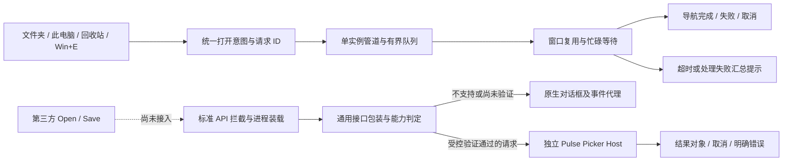

# Pulse 系统入口与第三方文件对话框重构

> 2026-10-30 路线调整：R24 记事本用户通过，但 Word 打开/另存为均仍原生。第三方仍是有限能力验证，暂停逐软件试错，改按标准接口能力与日常启动机制推进。当前结论及剩余初步预算以 [通用接入路线](third-party-dialog-generalization.md) 为准；下方历史进度不代表当前全覆盖。

> 2026-10-30 最新进度：工作区 shell-integration-latest 已完成系统请求统一队列、后台接收、确定性路由与 Explorer 呈现后关闭保护；实机正常/忙碌恢复/到期/退出均通过。最新版四类 cold 命令与真实第二进程 hot 测试通过，保留独立 Win+E 策略。第三方方面，R7/R8 的真实 Edge 打开/保存成功已有原日志；R9 固定版本包获得用户“打开、保存和取消都正常”反馈，当前日志直接确认两类 Pulse 窗口显示及取消。完整包自动验证与绑定配置已通过定向及实际启动验证。日常管理入口已实现，后台真实启动/停用/退出39项检查通过，实际组件包/应用选择及取消已验证；实机发现并修复双窗口选择器焦点恢复，三个前景场景通过。新增记事本验证暴露系统转发入口与子进程接入缺口，正在补日志定位，尚未验收第三方全面接管。真实默认关联验收、已有进程与全应用覆盖尚未完成，不能称全面接管完成。详见[基线与系统验收](shell-integration-baseline-alignment.md)及[第三方桥接记录](third-party-dialog-bridge.md)。原人日预算不是剩余报价。

> 2026-10-29 基线纠正：本文此前实施及测试来自 `C:/Users/SS/Desktop/pulse`（HEAD `c4f51bb`）。用户指出的最新 1.0.58 代码位于 `C:/Users/SS/.codex/worktrees/pulse58-integrated-fixes/pulse`（HEAD `9b48b68` 加未提交修改），两者尚未合并。本表的通过记录仅适用于旧工作区，不认证最新版。旧工作区功能修改和运行已暂停，正在按新版打开策略整理迁移；不得用旧文件整份覆盖新版。原工作包人日也属于旧基线预算，不能作为最新版的剩余报价；完成增量对齐后再调整。

新版 Win+E 注册使用 `--win-e`，进入 `pulse:win-e` 和独立 `open_win_e` 策略；Pulse 图标、此电脑另有 `open_pulse_icon` / `open_this_pc`，Ctrl+N 已恢复。此前将无参数 cold 启动称作 Win+E 命令验证的结论仅适用于旧实现，必须在新版重写，不能沿用。保留新版策略，只迁移本任务的请求可靠性、来源关闭保护和对话框桥接增量；迁移后定向验证受影响链路。

日期：2026-10-28。依据当前工作区（含已有未提交修改）的分析、分阶段实现与本机定向验证。原始用户反馈不等于每一种桌面场景均已复现或修复。

## 旧工作区阶段记录（不可作为最新版验收）

| 范围 | 已实施及证据 | 尚未完成 |
| --- | --- | --- |
| 系统打开请求 | 类型化意图、有界队列、独立管道、请求去重、可查询终态；管道 29 / 交接 54 / 端点 30 项通过 | 真实生产桌面全部关联入口、跨用户/会话验收 |
| 窗口忙碌 | 固定 30 秒等待、恢复后执行、超时/处理失败分类提示；38 项通过，含三语两行字体测量；浅/深色、窄窗口及关闭已实际检查 | 生产外部入口持续负载及跨实例矩阵 |
| 主程序 | 构建成功；本机隔离窗口文件夹/此电脑/回收站与返回导航已操作 | 不等于外部 Shell 入口全量验收 |
| Explorer 完成与退出 | 统一拥有请求的队列；最新呈现专项 35、关闭 scope 25 项通过；真实 Explorer 成功接管、忙碌到期及受控 Pulse 崩溃保留来源均通过 | 真实默认关联入口、多标签及其他桌面矩阵仍待验收 |
| 入口命令 | 四类 cold 命令的生成、参数、实际呈现与清理通过；Windows 显式 Directory/open CLASSKEY 调用到实际 Pulse 呈现通过 | 默认关联选择、真实桌面双击与 Win+E 按键不由显式类键测试证明 |
| Save 确认后复核 | 后台身份复核 32 项；实际界面两次各 13 项通过；跨位数取消定向 10 项通过 | 初轮偶发就绪失败未复现、原因未知；默认原生访问验证仍待补齐 |
| 通用对话框基础 | 协议 x86/x64 各 1038 / 管道 69 / 映射 30 / 调用器 23 / 宿主组合 103 项通过 | 架构与应用兼容矩阵完整覆盖 |
| 显式 COM 包装 | 含 IFileDialog2 与完整验证上下文，两架构各 81 项；原生回退事件/控件各 77 项；契约模型各 76 项；快捷方式保留各 19 项、过滤器手输接受各 20 项、显式 NOVALIDATE 宿主各 55 项 | Pulse 侧事件、自定义控件、默认校验兼容，生产验证门禁仍关闭 |
| 受控标准接口接入 | 创建适配各 71 项；自有 x86/x64 EXE 静态 CoCreateInstance 接入及卸载恢复各 48 项、真实宿主全链路各 38 项通过 | 动态入口、第三方进程装载；尚未上线第三方自动替换 |
| 扩展 COM 创建 | CoCreateInstanceEx 显式适配各 36 项、真实宿主 32 项；类工厂适配各 49 项、真实宿主 32 项通过 | Ex/类工厂入口的自动拦截与进程装载；未知工厂接口的兼容边界 |
| 传统 W/A 接口 | W 显式适配 25 项、真实宿主 29 项；A 编码及混用错误状态 ACP 936 下 44 项、UTF-8 下 53 项，A 真实宿主 32 项通过 | 入口拦截、其他系统代码页及生产 ABI 校验覆盖，生产验证门禁仍关闭 |
| 原生对照 | 基础对照、默认 Open 与显式 NOVALIDATE、默认 Save 五例已分别跑完；最新 Save 功能失败 0 | 各批测试 GUID 的 ClearClientData 仍 E_FAIL（最新 Save 5 项），整体不得标通过；默认 Save 同意覆盖后的行为仍待补齐 |
| 跨位数桥接 | x86 创建/Ex/工厂 71/36/49，W/A/UTF-8 25/44/53 项；x86 调用方→x64 宿主五条显式专项 26/32/32/29/32 项、IAT 38 项、受控 DLL 51 项通过 | 第三方自动装载，其他架构与旧系统 |
| 受控 DLL 装载 | C ABI、生命周期与独立夹具 API，x86/x64 各 173 项通过；DLL 到真实 picker 打开/保存/取消及旧配置快照各 51 项通过 | 仅非发布测试 DLL；精确夹具匹配不属于通用生产验证策略，第三方自动装载未实现 |

成本为从重构基线开始的产品化预算，见“工作包与成本”；不是剩余工期承诺。下面实施记录按时间追加，较早的“尚未实现”描述只代表当时阶段。

当前验证使用工作区 `build/pulse.exe`，没有覆盖 `Program Files` 中已安装的 Pulse，也没有开启第三方全局替换。整体尚不能按可发布完成验收。

下一阶段按以下顺序推进：

1. 在已通过的真实 Explorer 交接和四类 cold 命令链基础上，补齐默认关联选择及其他桌面场景；保留成功后关闭、期限取消及异常退出来源可用的约束。
2. 补齐默认 Open/Save 的验证、事件和控件兼容；显式 NOVALIDATE 已通过的受控能力不能替代默认行为验收。
3. 实现及验证第三方进程的装载、标准入口覆盖、停用与升级策略；现有显式调用和自有进程 DLL 测试不等于自动接管已完成。
4. 完成真实系统关联入口及发布/回滚矩阵，之后再决定发布范围；不以构建成功或测试总数代替这些条件。

## 目标与边界

系统文件夹、驱动器、我的电脑、回收站、Win+E、外部定位文件使用统一请求链路，避免重复打开与静默丢失。第三方打开/保存对话框独立立项，复用浏览组件，不共用接管机制。保留已有未提交工作，不重写无关模块。

## 重构开始时的实现与风险

- `single_instance_coordinator.*` 已有端点、版本化请求、GUID 和期限去重。同一发送重试保持 ID，但不同入口没有天然共享 ID。
- `open_routing.cpp` 和 `external_open.cpp` 已有标签/窗口复用、智能与批次策略。近期输入、忙状态和批次提升都会主动创建窗口；空参数表示新窗口，我的电脑不参与普通路径去重。
- `app_main.cpp` 接收后异步投递打开；收到不等于显示成功。当前投递失败会退回同步打开，可能在 IPC 回调内执行阻塞操作。
- `explorer_window_takeover.cpp` 和 `explorer_handoff.h` 已有导航交接、取消、确认后关闭源窗口的保护，必须保留。
- `shell_integration_registry.cpp` 已有备份、升级日志和恢复。默认管理器总开关依次应用多个入口，需要明确部分成功状态与跨入口恢复。
- `folder_picker_dialog.*` 是 Pulse 自用选择器，不代表完整的第三方文件对话框兼容层。

## 目标架构

两条入口独立实现和验收。系统默认文件管理器注册不会自动替换应用内部的打开/保存调用；右侧桥接开始后不会因失败再自动弹第二个对话框。

入口适配器 → 类型化请求 → 单实例请求服务 → 唯一打开决策器 → 导航执行器 → 终态回执。

1. 请求包含 ID、来源、来源进程/窗口、期限、操作、目标类型/标识、选择集合、窗口策略和可选批次。禁止空字符串复用多种语义。
2. 状态为 Received、Queued、Executing、Presented、Failed、Cancelled。接收确认与展示确认分开。投递失败不得保留成功去重记录；相同 ID 可以安全重试。
3. 后续采用版本化命名管道和独立接收线程，校验用户/会话、调用方、长度与权限；UI 操作仍留在 UI 线程。旧协议短期适配到同一服务。
4. 同 ID 重试去重与跨入口关联分别处理。不能仅用短时间相同路径吞掉合法操作。
5. 单实例服务不承诺跨进程崩溃的绝对 exactly-once；重启后的结果不明需要可查询和显式恢复策略。

## 产品行为

| 场景 | 目标行为 |
| --- | --- |
| 普通目录、我的电脑、回收站 | 已打开则激活，否则标签页；虚拟位置有明确身份 |
| 明确新窗口 | 新建窗口，不被路径去重吞掉 |
| Win+E | 独立偏好与操作类型 |
| 多选目录 | 显式批次，不自动搬移既有标签 |
| 隐藏/最小化 | 恢复并呈现目标 |
| 忙、模态、导航失败 | 排队、取消或明确失败，不静默成功 |
| 不支持 Shell 对象 | 原生回退并记录原因 |

改变既有窗口偏好前保留迁移说明与用户明确设置。Explorer 观察器只能提交请求，不能维护另一套窗口策略。成功导航与选择确认后才允许关闭源窗口；多标签 Explorer 无法证明安全时保留源窗口。原生回退带临时放行标识，避免再次接管。

## 注册、升级与诊断

- 分离期望配置、实际归属、健康状态；呈现部分接管、残留、路径失效与其他软件接管。
- 复用现有原始值备份、所有权判断与升级日志；恢复不得覆盖其他软件后续修改。
- 日志按 request ID 串联来源、接收、队列、决策原因、窗口/标签、导航与终态。默认不记录完整敏感路径；用户导出诊断时说明内容。
- 新旧入口迁移到同一核心，逐入口灰度；提供停用、修复和回滚。禁止两套消费者同时创建窗口。

## 第三方对话框

按用户2026-10-28补充要求，采用通用接口兼容层，不按应用逐个实现。统一覆盖现代IFileOpenDialog/IFileSaveDialog及旧式GetOpenFileName/GetSaveFileName；应用名单仅用于灰度和验收，例外回退原生。技术验证使用受控调用方，不把协作调用方作为最终产品的前置条件；自绘对话框不承诺全覆盖。

完整桥接需要独立 Picker Host、应用侧适配，覆盖打开/保存/文件夹、多选、过滤器、扩展名、覆盖确认、取消/错误、模态父窗口、焦点、回调、自定义控件、应用退出及 x86/x64。ARM64 和旧系统单列支持范围。不支持契约时回到原生。保存内容仍由调用应用写入。

参考：[Common Item Dialog](https://learn.microsoft.com/windows/win32/shell/common-file-dialog)、[IFileSaveDialog::ApplyProperties](https://learn.microsoft.com/en-us/windows/win32/api/shobjidl_core/nf-shobjidl_core-ifilesavedialog-applyproperties)。

## 工作包与成本

估算假设：熟悉项目的 Windows C++ 开发、有测试支持、Windows 10/11 x64、复用现有组件。包含定向验证，不是承诺工期。

| 阶段 | 内容 | 人日 |
| --- | --- | ---: |
| 0 | 链路诊断、竞态复现、基线 | 4–6 |
| 1 | 请求协议、排队、回执、启动竞争 | 8–12 |
| 2 | 路由、虚拟目标身份、窗口策略 | 6–9 |
| 3 | 注册健康、升级、恢复 | 6–10 |
| 4 | Explorer 适配、来源关联、安全回退 | 7–12 |
| 5 | 集成验收、灰度、故障注入 | 8–12 |
| 合计 | 系统入口重构 | 39–61 |

含约 20% 风险余量预算 47–73 人日：单人约 10–15 周；两名开发配测试约 6–10 周。费用按团队综合日成本换算，另计签名、虚拟机与维护。

第三方采用标准接口通用桥接，不按应用逐个开发。独立估算为 63–108 人日，分项见 [第三方桥接方案](third-party-dialog-bridge.md)；这是从基线开始的完整产品化估算，不是已经实现部分的剩余工作量，也不与旧的应用数量估算叠加。系统入口与桥接合计约 102–169 人日，另留风险预算。Windows 8.1 同等支持暂留相关工作量 20%–35% 风险预算；广泛应用兼容持续投入，不固定承诺全覆盖。

## 验收与实施记录

定向覆盖：同 ID 重试一次执行、独立新窗口不误去重、队列失败后可重试、冷启动并发、端点未就绪、退出竞态、虚拟目标、隐藏窗口、取消/关闭、UNC/长路径/权限、注册失败恢复、Explorer 保留与回退循环、保存取消/过滤器/覆盖确认。

优先复用 open_handoff、single_instance_endpoint、external_open、integration_registry 及恢复测试。只构建受影响目标，不默认运行完整历史回归。UI 和真实 Shell 行为单独验收，编译不等于功能通过。

- [x] 保存方案并开始实施。
- [x] 首批：移除 IPC 排队失败后的同步打开，失败回滚去重记录，补失败重试回归。
- [x] 统一类型化请求与链路诊断（保留旧发送协议兼容）。
- [x] 请求服务与状态查询（独立管道及新主程序隔离实例验证通过）。
- [x] 确定性窗口策略和虚拟目标复用（全部忙时暂用安全新窗口，等待队列另列）。
- [x] Explorer 适配迁移及真实成功、忙碌、崩溃场景验证。
- [x] 四类注册命令 cold 链路与显式 Directory/open Shell 解析验证。
- [ ] 默认关联选择、注册恢复与其他桌面场景完整验收。
- [ ] 系统集成验收和灰度。
- [x] 第三方标准接口桥接基础及受控跨位数宿主技术验证。
- [ ] 默认校验兼容、第三方通用装载与真实应用验收。

### 首批验证（2026-10-28）

- `cmake --build build --target pulse pulse_open_handoff_test` 成功。
- `build/pulse_open_handoff_test.exe` 退出码 0，28 条 PASS，含新增的失败回滚、错误回滚保护与重试去重用例。
- `git diff --check` 通过，仅有工作区换行符提示。
- 本批测试验证去重状态回滚；未注入真实 PostMessage 队列失败，未进行真实桌面双击或 Explorer UI 验收。
- 排队失败会明确返回失败；发送端当前收到拒绝后退出，自动区分可重试拒绝与永久拒绝留待版本化回执阶段。
- 本批不是整个重构完成；后续状态机、诊断、窗口策略、第三方兼容仍待实施。

### 连续实施进展（2026-10-28）

- 请求增加显式 Navigate / NewWindow / ThisPc / RecycleBin 意图，v3 携带操作，v2 兼容解析。默认启动转发仍发 v2，避免新启动器向旧实例静默降级 typed 请求。
- 去重身份同时校验操作；无效操作和互相矛盾的虚拟目标拒绝。排队失败返回可重试回执，发送方保持同 ID 与原期限。
- 日志记录请求 ID、操作、接收/重复/排队/执行/路由；不记录路径。正在接入导航终态和按 ID 查询，不能把 dispatched 当 presented。
- Smart 不再因近期输入或时间批次提升新窗口；明确新窗口优先复用，AlwaysWindow 优先批次。所有窗口忙时暂保留安全新窗口，完整等待队列仍待实现。
- 我的电脑与回收站按目标身份复用标签；普通 NewTab 语义不改。
- Explorer 迟到选择没有完成回执时保留源窗口；等待关闭阶段身份变化不再强制 Quit。
- 注册管理新增逐入口结构化结果并由真实 SettingsController 消费；保存各入口失败、实际生效与归属，不因后续成功丢掉错误，不自动关闭其他入口。

已验证：请求协议及状态查询40项、独立进程端点30项（含同ID临时拒绝重试）；生命周期15项；窗口策略51项；默认管理器25项、设置集成16项、Explorer策略13项。注册关联和持久化边界恢复程序退出码0（使用隔离HKCU测试键）。最新主程序构建成功。

真实Pulse隔离实例窗口、终态查询及日志检查通过：14个独立请求恰好各一次到达Presented；同ID重试去重；我的电脑和回收站重复请求激活已有标签；定位文件确认实际选中项后完成。脚本为`scripts/test_external_open_routing.ps1`，测试夹具与进程ID保留在bench_data；清理仅针对自身实例和经PID/父PID/创建时间/完整路径/命令行核验的测试辅助进程。该测试未验证真实桌面关联双击、Explorer源窗口交接或像素布局。

生命周期已接入生产目录/ThisPC/回收站加载：Queued→Executing→Presented/Failed/Cancelled，重复请求查询共享状态，旧导航/刷新/关闭取消未完成lease；接受期限与执行期限分开。Presented表示目标pane可见且模型/选择已就绪，不等于DWM绘制完成。请求状态当前仅在进程内缓存保留，旧请求记录可随期限清理；独立命名管道服务已实现，未实现跨崩溃持久化。

多语言提示已通过catalog生成与--check，超时不再承诺稍后必定出现。依赖重新编译暴露未改动文件fluent_menu.cpp和ui_renderer.cpp的C4456局部变量遮蔽警告，未扩展修复范围。

环境记录：普通受限执行无法创建注册表测试键或写运行日志；获准使用隔离测试后通过。控制器测试清理最初被自动审核拒绝，已改为唯一测试路径、重定向标记校验及显式scratch句柄清理后获准通过。没有修改真实系统关联。

### 第三方对话框技术验证结论

初始代码的 PickerMode 只有 Folder/Image/File，没有 Save，ShowFilePicker只返回bool；本次已增加 Save 路径验证和明确的接受/取消/失败结果。跨进程调用方 owner 禁用/恢复仍需调用方桥接实现。默认文件管理器关联不能成为任意应用Open/Save调用的接收入口。

受控验证先使用自有调用方，产品通过进程内标准接口拦截层连接独立Picker Host。协议需固定宽度版本头、request ID、能力协商、OpenFiles/PickFolder/SaveFile、过滤器与结果索引、明确Cancelled/Unsupported/Failed。Save契约完成之前必须返回Unsupported并原生回退，不能宣称Save已替代。对话框被用户取消时不得回退再弹一次。断连和host崩溃必须先恢复owner。注入入口与API拦截本身是不同机制，必须分别设计、按位数构建并验证。

当前代码未实现第三方注入或通用COM兼容桥；任意应用全量替换不能作为已完成项目宣称。Picker 专用管道已实现实际进程、用户与会话校验，独立宿主正在真实进程验收。应用名单只用于兼容测试与例外禁用，不作为接入架构。参考微软Common Item Dialog与IFileSaveDialog接口文档。

### 通用对话框阶段验证（2026-10-28）

- 严格协议 codec：746 项检查通过；独立管道通信最新 69 项检查通过，包含对端退出后的完整回复读取与截断拒绝。
- Save 模型与后台验证定向检查通过；真实保存界面 7 项通过，取消/失败/接受结果 6 项通过。测试仅使用 bench_data 隔离夹具，确认新文件未被创建、已有文件未被改写。
- 保存截图已检查，无明显裁剪重叠；测试截图只含合成背景层，不包含独立 EDIT 子窗口，不能据此判定输入框文字显示。补充的实际文字断言已通过，最新 Save UI 共 8 项通过；完整像素验收仍有限制。
- 独立宿主首轮 45 项检查中 2 项失败，定位为测试在 WM_CREATE 阶段过早发 Enter。修正为等待实际窗口显示/输入可用，保留结果断言并增加输入文本检查；最新 75 项全部通过，包括 Open、Save、新路径不创建、取消、错误 ID 和断连退出。
- 接收请求的有界队列最新回归 53 项通过，隔离 Pulse 实例 15 个请求中 14 个 Presented、1 个缺失路径 Failed，同 ID 重试未重复执行。

### 独立系统请求服务（2026-10-28）

- 新增当前用户/会话本地管道，端点 v2 在服务可用后发布能力；旧端点仍走 WM，新端点回复不明时不降级重复打开。
- UI 不泵消息时接受并排队；生命周期留在 UI，后台只读原子状态。未提交入队的重复请求返回 Retry，迟到回滚不能删除成功重试。
- 回复后有界等待客户端读取确认；停止取消挂起读写后汇合线程，再清理队列。
- 最新独立管道 29 项、交接 54 项、端点 30 项通过，无新增构建警告。覆盖真实延迟读回复、6 个并发客户端同 ID、冷启动、半帧退出、丢失响应和混合入口竞态。
- 当前用户内实际进程身份拒绝已验证；真实跨用户/跨会话和生产桌面 Shell 仍需对应环境验证，不列为通过。

### 调用方桥接（2026-10-28）

新增独立进程调用器，等待期间泵消息，保留原 owner enabled 状态，宿主由私有 job 管理，协议不支持/错误直接返回且不自行再弹原生窗口。审查后补强 owner 身份、同步销毁、同线程重入、取消与完成竞争和 WM_QUIT 保留；最新 23 项全部通过。真实 Pulse 新主程序的系统打开请求、终态和重复请求日志再次通过。该调用器不是 API 拦截器，不会自动改变第三方应用。调用器→真实 Picker Host→实际 Open/Save/取消→owner 恢复的组合测试已通过，宿主测试最新共 95 项通过。

### 标准接口契约（2026-10-28，尚未接入拦截）

- 传统 Unicode OPENFILENAME 模型 45 项通过，覆盖有界字符串、过滤索引、单多选缓冲格式、精确容量、不足回填和失败零写入。Ready 只表示可编码；CWD、文件校验和只读兼容仍是实际 ABI 接入门槛。
- 现代 IFileDialog 设置模型 49 项通过，保留真实 setter HRESULT、调用顺序、SetOptions 替换语义与明确 NativeOnly 原因。结果对象及原生校验门槛未满足前，不能将 Prepared 当作自动接管许可。
- 真实 Shell 结果转换 26 项通过，覆盖本地 Open/Folder/Unicode/Save 无创建及长路径。系统可能返回 8.3 路径；测试通过卷号/文件 ID 或不存在 Save 的父目录身份+相同叶名验证同一位置，并包含不同文件身份负例。UNC 没有隔离共享环境，明确未测。
- 实际 COM 包装、标准入口拦截、进程装载、x86 和第三方真实应用兼容仍未完成；不把这些模型测试计作自动替代已上线。

### 快捷方式与原生对照（2026-10-28）

新增显式 NoDereferenceLinks 选项和 PreserveLinks 必需能力，只在请求该能力时返回 `.lnk` 自身，默认解析行为保留。协议最新 812 项、映射 24 项和 loader `--links` 专项通过；真实 client→host→UI 的 `.lnk` 选择通过，宿主组合测试最新 103 项通过。

原生 IFileDialog 对照尚未通过：普通 Open 候选组合实际接受成功，但锁定文件的默认验证提示使测试驱动超时；测试专属历史清理在受限环境返回 `0x80070005`。新版本已将随机 ClientGuid 写入隔离 fixture journal，正修复关闭驱动及精确清理。首轮 `PulseNativeContract-32464-45405859` 没有记录 GUID，无法从日志唯一恢复，未猜测或全局清理；第二轮 `PulseNativeContract-27696-45954281` 的 GUID 已记录。两轮夹具暂保留作失败证据，不能把原生兼容门槛标为通过。

### 用户授权直接本机验证

用户后续明确要求“直接我本地测吧。我本地有现成的软件”。因此不再等待虚拟机或以测试历史清理成功为继续功能验证前提；清理失败仍独立保留，不改判通过。放开受限执行后的精确 GUID 清理确认：COM 初始化、对象创建和 SetClientGuid 均成功，仅 ClearClientData 返回 `0x80004005`，尚未确认原因。未进行全局历史清理。

通过 computer-use 在本机记事本的新窗口验证原生行为：打开取消恢复、打开隔离 source.txt、另存为取消恢复、输入无后缀 saved-copy 后生成 saved-copy.txt。源文件与保存副本 SHA-256 均为 `B7DECE257F54AB85855F1DD7F25BA1C42CA0542753DEDEAFB97D64E506293BA8`，测试窗口已关闭。夹具位于 `bench_data/local-dialog-probe-90c95dcb833c4f9f8b623bebcf482cd8`，没有操作用户正式文档。

记事本打开/保存对话框包含编码选择控件；这属于通用自定义控件兼容需求，不能只返回路径而忽略它。本次是原生兼容基线，尚未宣称该现成软件已自动使用 Pulse 对话框。应用版本未从本次本机查询取得，未猜测版本号。

### 本机对照与忙碌队列最新结果

原生对照驱动修复后已完整退出，不再触发 watchdog。日志为 `bench_data/native_file_dialog_contract_latest.log`，本轮历史清理 journal 为 `bench_data/PulseNativeContract-31028-49438828/native-client-guids.tsv`。普通打开、NOVALIDATE 下打开锁定文件、返回快捷方式本身、新保存路径返回且不创建文件、只读保存未被接受、显式取消均有实际结果。默认验证的锁定打开仍停留在提示中，由测试取消；该观察不能替代完整校验兼容证明。测试整体 exit 1：7 项失败均为测试 GUID 的 ClearClientData 返回 E_FAIL；未删除断言、未改判通过，测试文件已清理，历史 journal 保留。

系统入口新增固定 30 秒忙碌等待：Smart/标签页模式下不因所有窗口忙而连续创建窗口，同一请求重试不续期。超时请求汇总为一次现有通知条提示，等待最近窗口可见且恢复可用、没有其他通知时显示，不抢焦点。24 项定向检查通过，覆盖真实消息窗口、定时唤醒、去重、超时、关闭清理、队列容量及通知汇总；主程序构建与实际界面检查另行记录，不能用模型通过代替。

下一阶段为显式工厂的通用 IFileOpenDialog/IFileSaveDialog 包装层。先验证 COM 身份、配置镜像、展示前原生回退、取消与结果对象，再接标准入口装载。尚未证明的原生验证语义继续保留门禁；开始桥接后不再回退弹第二个对话框。

### 显式 COM 包装层及本机界面复核

新增 `src/shell_bridge/file_dialog_wrapper.*`，显式工厂持有真实原生对象并镜像配置，统一 COM identity 与引用寿命。51 项定向检查通过，覆盖展示前能力回退、默认验证门禁、取消、失败不重弹、真实 Shell 返回值、重入及线程约束。事件订阅、自定义控件仍明确不支持；这不是可直接用于任意第三方的透明替代层。默认门禁保持关闭，尚未装载到第三方进程。

主程序构建成功；只出现已记录的 `fluent_menu.cpp` 与 `ui_renderer.cpp` 两处旧变量遮蔽警告。通过本机可见隔离实例复核普通文件夹列表、回收站加载、此电脑磁盘列表及返回导航，窗口布局未见明显裁剪或重叠；测试窗口已关闭。本次手动复核属于内部导航，不冒充桌面双击或外部请求排队验收，超时通知实际显示仍待独立验证。

原生对照诊断修复后重新执行，普通打开正确记录 accepted；默认验证的独占锁文件新增明确不接受断言并通过。仍仅 7 项 ClearClientData 失败，最新 journal 为 `bench_data/PulseNativeContract-7092-50653578/native-client-guids.tsv`，不标为整体通过。

包装层到真实进程的专项 `pulse_picker_host_test build/pulse.exe --wrapper` 已通过 26 项：Open、Save 新路径且不创建文件、Cancel 均实际经过包装层、调用器、Picker Host 和结果对象。调用方在展示期间禁用，终态后恢复；原生 Show 调用计数全部为零。测试只批准精确隔离夹具的请求，生产验证门禁没有放开。

### 后续边界修复（2026-10-29）

队列满导致无法继续暂存、唤醒失败导致清队两处此前只有终态而没有反馈，现已加入独立处理失败计数，与超时汇总显示，退出及重复收尾不重复报告。原通知正文最多两行，混合提示曾使用双段文字，会裁掉后一类失败；已改为专用短文案。最新 38 项通过，包含实际三语 catalog、最大 uint32 计数、实际字体、常见/窄宽度和 100%/125% 字号的两行测量。此测量不替代通知卡片完整交互截图。

事件代理已增加真实原生订阅和七种事件转发。`--wrapper-events` 的真实原生 OnFileOk 身份、S_FALSE 否决及回调内 Close 功能断言通过；两项 GUID 历史清理仍失败，日志 `bench_data/native_wrapper_events_latest.log`。独立事件测试暴露未知 cookie 取消时访问异常（`0xC0000005`），诊断记录 `bench_data/file_dialog_events_diagnostic.log` 保留。本地订阅编号校验已修复，禁止将未知或已取消编号传给原生；事件阶段须以修复后的独立复测为准，当前不标整体完成。

修复后复测：事件代理 38 项、包装层 51 项、最终 Pulse 真实链路 26 项全部通过。未知/重复取消返回包装层明确的 E_INVALIDARG，不影响有效订阅；有效取消先移出登记表，防止回调重入重复取消。修复后的真实原生事件专项功能再次通过，仍有两项历史清理失败；不将此套件整体标通过。最终主程序构建成功，新增代码无编译警告，仍只有前述两处旧警告。后续继续原生自定义控件/控制事件兼容和通知卡片实际显示验收。

### 自定义控件与测试隔离

原生回退已支持 IFileDialogCustomize 的 27 个方法和 IFileDialogControlEvents 的四种事件，保持 wrapper 的统一 IUnknown 身份。相关事件/控件测试最新 77 项，包装层 52 项，真实 Pulse 链路 26 项通过；这些控件目前仍走原生，不代表 Pulse 侧已渲染第三方自定义控件。

在可见原生测试窗口实际选择 UTF-16、勾选 Test option、打开 source.txt：OnItemSelected、OnCheckButtonToggled、OnFileOk 均回传正确参数和 wrapper 身份，最终文件与夹具一致。日志 `bench_data/PulseControlVerification-35028-79148375/verification.log`：功能失败 0，清理失败 1（ClearClientData E_FAIL）。此前一次因界面控制授权超时而触发 90 秒保护退出，不计为通过，记录保留在 `PulseControlVerification-32148-54677468`。

通知探针实际复核浅色、深色及约 720 像素宽窗口，混合计数文字完整。关闭验收遇到自动更新卡片异步替换，误触发更新。安装日志 `%TEMP%/Pulse-Setup-20261029-001955.log` 确认目录/scope 校验在解包前以退出码 7 拒绝：测试目标为工作区 build，正式安装在 Program Files；对应程序版本与时间戳未被此次更新改写。此误操作不隐去，也不把关闭操作计为通过。已给严格通知探针增加更新隔离，普通实例行为不变，待重新验收关闭。

更新隔离重建后，使用新探针 `notice-probe-5cd451a31af84b90a260aeda3d8fe658`（PID 30280）重新验收：真实卡片关闭后淡出，后续观察没有重弹；对应 runtime log 中更新检查、下载及安装启动事件计数为 0。测试窗口已关闭。本探针只验证实际通知渲染/关闭路径，不能替代真实桌面关联的完整端到端验收。普通生产通知之间的异步替换行为没有在本次探针隔离修复中改写。

### 标准调用入口准备

显式现代创建适配 `file_dialog_activation.*` 已通过 61 项检查。原始 CoCreateInstance 按原 CLSID/IID/context 调用一次，包装同一个原生对象；禁用、未知接口、聚合、额外 context 标志、非 STA 等原样旁路；递归进入不再包装，包装失败交还原接口。包装层 52 项与真实宿主 26 项复测通过。此层尚不是全局 hook。

显式传统 Unicode 适配 `legacy_adapter.*` 的 25 项检查通过：OPENFILENAMEW 单/多选和 Save 回填、容量不足仅写首 WORD、取消/失败零部分写入、线程局部扩展错误及原生回切。初次 Unsupported 用例响应不符合协议，已修正测试载荷并保留不重弹/缓冲不变断言。默认验证 gate 仍关闭，Prepared 不代表原生语义已经认证。仅接受有效调用方内存与真实容量；其他颜色/字体等公共对话框需显式切换错误来源，不能假称 TLS 会自动感知未经过适配层的调用。ANSI 与全局错误查询拦截尚未实现。

传统适配到真实宿主的 `--legacy` 专项 29 项通过，覆盖 Open/Save/Cancel 的 BOOL、扩展错误、文件名/标题/偏移/索引/flags、尾部缓冲保留、owner 恢复及 Save 不创建目标。原生回退调用计数为 0，仅精确夹具通过测试用 gate；尚未开放生产范围。

受控标准入口 `pulse_file_dialog_iat_test` 构建成功且 37 项通过，日志 `bench_data/file_dialog_iat_latest.log`。真实静态 `::CoCreateInstance` 进入创建适配与包装；重复安装拒绝、禁用旁路、递归保护、原生失败、外部槽冲突及卸载后原始入口/页保护恢复均有检查。在途调用持有配置，卸载后迟到 thunk 仍安全调用原始函数；卸载不是排空屏障，之后重装可能让迟到调用采用新配置。此阶段只修改明确指定的当前主 EXE 导入槽，dispatcher 同 EXE 常驻至进程退出，不生成代码、不注入第三方、不拦截动态 GetProcAddress、delay-load 或 DLL。37 项通过不等于已覆盖上述入口，也不等于生产语义门禁开放。

后续审查修复 IAT 安装结果的异常报告：已有安装时，新配置复制抛异常或新请求被拒绝，结果仍反映原有安装与权限恢复状态，不能报告假卸载。新增异常及旧配置继续工作的回归，最新独立 IAT 检查 41 项通过。

`--iat` 真实宿主专项首次 38 项中 24 项失败，尚未启动宿主。反汇编证实编译器将两次 `&CoCreateInstance` 比较折叠为恒定结果；已改为读取实际 IAT 槽，保留安装/恢复断言及真实 API 调用。首次日志和反汇编分别保存在 `bench_data/picker_iat_host_first_failure.log`、`bench_data/picker_iat_host_first_failure_disasm.txt`。修复后 38 项全通过，最新日志 `bench_data/picker_iat_host_latest.log`：Open/Save/Cancel 每例一次真实 client/host、没有原生 Show，终态恢复 owner；Save 不创建目标，卸载恢复槽后原生对象可创建。只给精确测试请求授权，未开放生产门禁。

ANSI 显式适配 `pulse_legacy_ansi_adapter_test` 初版 33 项通过，无 SKIP，日志 `bench_data/legacy_ansi_adapter_latest.log`。使用实际 ACP 严格双向往返，多字节路径按字节计算偏移与容量；不可表示或 best-fit 结果原子失败，不丢字符、不重弹原生。覆盖多选双 NUL、缓冲不足只写首 WORD、取消/错误保持缓冲、32 KiB 多选边界及原生旁路。尚需真实 host 与 A/W 混用错误状态验证；不因适配器测试通过宣称旧式全局接口已经接管。

传统接口后续完成共用 `legacy_dialog_error.*`：A/W 成功、失败、取消和原生旁路统一同线程状态，错误查询不提前调用或缓存原生值，外部公共对话框仍需显式切换来源。ANSI 检查增至 44 项全通过，实际 ACP=936，无 SKIP；W 原 25 项复查通过。真实 `--legacy-ansi` 32 项、`--legacy` 29 项通过：打开/保存按实际编码回填文件名、标题、偏移和 flags，取消保持结构/缓冲，Save 不创建目标，owner 恢复。日志为 `bench_data/picker_legacy_ansi_host_latest.log` 与 `bench_data/picker_legacy_host_latest.log`。本机 ACP 验证不等同于 UTF-8 ACP、其他 DBCS 或 x86 均受支持。

为后续多接口 COM 创建入口共享递归保护，抽出内部 `file_dialog_activation_scope.h`。原创建适配 61 项及 IAT 41 项已定向复查通过，尚待扩展创建入口本身验收。

扩展创建适配 `pulse_file_dialog_activation_ex_test` 36 项通过：原 CoCreateInstanceEx 一次创建，多 IID 共享同一 wrapper 身份，部分成功/失败、不支持输入与包装失败全量保留原结果；两种创建入口相互递归不双重包装。`--ex` 真实 host 首轮 32 项中 18 项失败，因测试输入 `MULTI_QI.hr=E_PENDING` 不满足零初始化要求而被保守旁路，尚未 Show。首次日志 `bench_data/picker_ex_host_first_failure.log` 保留；修正测试输入并增加引用/身份诊断后，32 项全通过，见 `bench_data/picker_ex_host_latest.log`。逐个释放 MULTI_QI 结果后保留接口仍可用，Open/Save/Cancel 完整经过真实宿主，没有原生 Show；未增加 Ex 自动拦截。

独立 UTF-8 manifest 测试进程实际 ACP=65001，`pulse_legacy_ansi_utf8_test` 53 项通过，日志 `bench_data/legacy_ansi_utf8_latest.log`。覆盖四字节路径/标题、字节容量与偏移、多选双 NUL、非法 UTF-8 输入及孤立 UTF-16 代理项结果的原子失败。合法 Unicode 在 UTF-8 下“不可表示”的用例明确标为 N/A，不计通过。首轮出现三处测试变量遮蔽警告，已仅重命名局部变量，重建无新增警告并复测通过。未改本机区域设置；该进程清单依赖 Windows 10 1903+，不能据此声称 Windows 8.1 支持。

显式类工厂路线 `pulse_file_dialog_class_factory_test` 47 项通过，真实 `--factory` 32 项通过，日志分别为 `bench_data/file_dialog_class_factory_latest.log`、`bench_data/picker_factory_host_latest.log`。真实 CoGetClassObject→IClassFactory::CreateInstance→wrapper→host 完成 Open/Save/Cancel，释放工厂后对话框仍可用；LockServer 保持原 BOOL/HRESULT，原生许可工厂整体旁路，跨创建入口递归不双包装。首版工厂代理只暴露 IUnknown/IClassFactory，返回代理后查询未知工厂接口得到 E_NOINTERFACE；这不是任意原生工厂接口的透明兼容。CreateInstance 请求未知对象接口则原样交给原生，两种边界不混淆。

开始在独立 `build-bridge-x86` 验证 32 位桥接目标，不构建 32 位主程序。首次发现测试辅助的 SIZE_T/size_t 模板推导差异（`picker_host_test.cpp` 的 std::min），已统一为同宽的 size_t 并保留边界检查。首次配置的中文编译器 include 前缀编码不匹配，已用 UTF-8 控制台重新生成专用测试构建；这些修复不等于 x86 功能验收通过，待实际运行记录。

重新生成后，x86 七个受影响桥接目标构建成功，无编译错误/警告，完整构建日志 `bench_data/bridge_x86_build_latest.log`。实际运行创建 61、Ex 36、工厂 47、W 25、A 44、UTF-8 53 项全部通过；UTF-8 的合法字符不可表示案例仍为 N/A。二进制 PE Machine 核对：`build-bridge-x86/pulse_picker_host_test.exe` 为 014C，`build/pulse.exe` 为 8664。32 位调用方连接 64 位宿主的 `--wrapper/--ex/--factory/--legacy/--legacy-ansi` 分别 26/32/32/29/32 项通过，日志 `bench_data/picker_<mode>_host_x86_latest.log`。此次确认的是受控调用方跨位数通信和返回契约，不包含 x86 IAT 或第三方注入。

后续补齐自有 EXE 的 x86 IAT：使用当前编译架构的 PE 头、thunk、ordinal 位与槽宽度，分别拒绝 Machine/Magic 不匹配和完整异架构映像，保留已有边界、权限恢复及生命周期约束。x64 与 x86 独立 IAT 最新各 44 项通过，两种位数 `--iat` 到 64 位真实 Pulse 宿主各 38 项通过；日志 `bench_data/file_dialog_iat_latest.log`、`bench_data/file_dialog_iat_x86_latest.log`、`bench_data/picker_iat_host_latest.log`、`bench_data/picker_iat_host_x86_latest.log`。此阶段仍只改当前主 EXE 的 CoCreateInstance 静态导入槽，Ex/类工厂/传统 API 自动拦截、DLL 装载及动态入口尚未覆盖。

受控装载新增明确非发布的 `PulsePickerBridgeProbe.dll` 与独立 C ABI 加载测试。测试 EXE 不链接桥接实现，通过稳定导出取得版本化函数表，仅修改当前主 EXE 导入槽；验证默认关闭、字符串复制、配置拒绝、在途 Show 停用、旧 wrapper/旧 thunk 在 FreeLibrary 后仍安全，以及异位数 DLL 加载被拒绝。Show 仅在确认对象来自 Probe 后调用，并固定返回取消；host_path 目前只是拥有所有权的配置，不启动真实 picker。安装清单未增加 Probe。

DLL 写入入口前必须 PIN 自身，停用撤销路由并恢复 IAT，不表示排空调用或可以卸载 DLL。代码保留到目标进程退出；失败也可能已经 PIN，状态必须如实报告。因此首版升级需要目标应用重启并从版本化路径装载新模块，不能承诺热卸载或零重启成本。

基础 DLL 装载 x86/x64 各 64 项通过。审查发现错误 size 的结构在拒绝前可能读到后续字段，已先独立检查 size，并加入后页不可访问的短头用例；修复后两架构各 69 项通过，日志 `bench_data/bridge_probe_load_x64_latest.log`、`bench_data/bridge_probe_load_x86_latest.log`。IAT 核心增加 EXE 不得调用 DLL 专用 PIN 入口的检查，各 46 项通过。另发现未 PIN 时的持久状态/事件可能在卸载后遗留，正在改为只读/拒绝请求不创建持久资源、未 PIN 不接受非空事件屏障、首次状态 RAII 持有并在 PIN 后发布；此问题修复验收前，受控 DLL 阶段不标完成。

未 PIN 生命周期修正后，x86/x64 装载测试各 87 项、IAT 核心各 48 项通过，双架构构建无新增警告。只读和拒绝请求使用常量初始化元数据；首次状态候选局部持有，未 PIN 失败释放，PIN 成功后在写入 IAT 前永久发布。新用例确认未 PIN 查询/拒绝后可真实卸载并干净重载，拒绝事件配置前后句柄数一致且调用方事件仍可用；安装后的在途调用、旧对象与旧 thunk 存活用例保留通过。这些证据是生命周期及调用级句柄检查，不宣称全面堆泄漏检测。后续继续受控 DLL 到真实宿主的专门链路，不把固定取消 Probe 当作生产对话框替换。

受控 DLL 到真实宿主链路已接通：新增独立版本协商的 `PulseBridgeProbeGetFixtureApi`，不改变原有 v1 函数表。仅 PIN 后接受最多 1 MiB 的现有协议请求，严格解码并复制，完整匹配请求体（只忽略请求 ID）。匹配配置使用真实 `RunPickerClient`；未匹配仍走 Probe 固定取消路径。配置替换只影响后续安装，已创建 wrapper 保留原配置和宿主路径，不把测试夹具匹配当作生产校验策略。

- x86/x64 C ABI 与生命周期各 173 项通过：包括保护页边界、错误版本/架构/长度/请求类型、复制后释放调用方缓冲区、失败保留原配置、清空和终态查询。证据为 `bench_data/bridge_fixture_load_x64_initial.log`、`bench_data/bridge_fixture_load_x86_initial.log`。
- 两种位数 `--dll` 到 x64 Pulse 真实宿主各 51 项通过：打开、保存、取消、旧 wrapper 在新配置被选中后仍完成原请求；检查 owner 恢复、保存不预创建文件、请求 ID、回传路径及新配置计数未被旧请求污染。证据为 `bench_data/picker_dll_host_x64_latest.log`、`bench_data/picker_dll_host_x86_latest.log`。
- 上述运行后将测试填充值改为明确的 `uint8_t{0xff}`，消除 C4244；两架构 loader 重新构建无警告，仅类型明确化后未重复运行功能测试。构建证据为 `bench_data/bridge_fixture_loader_x64_rebuild.log`、`bench_data/bridge_fixture_loader_x86_rebuild.log`。

仍只在自有测试进程显式装载 DLL，安装器不包含 Probe；没有第三方进程注入、生产全局开关开放或任意应用兼容承诺。

### 扩展接口与呈现确认修正（2026-10-29）

`IFileDialog2` 只在同一原生对象实际支持时暴露，Open/Save 共享原有 COM 身份。取消按钮文字和导航根目录交由原生实现并保留返回值，设置后原生展示；仅查询接口不强制旁路。桥接期间或结束后拒绝把新设置写入另一个未展示的原生对象。三种创建适配均识别该接口。

验证回调改为接收完整 `ContractDecision`：原始有效 options、操作校验类别、运行时义务及请求。最后成功的 SetOptions 按整体替换记录，未知成功码保留未知状态，后续设置不会抹掉之前的阻断原因。该信息不代表认证，生产默认仍关闭，未扩充选项白名单。

x86/x64 本机各通过：wrapper 81、single activation 71、Ex 36、class factory 49、events 77、contract 62。更新后 DLL→真实宿主各 51 项仍通过。日志为 `bench_data/dialog2_*_{x64,x86}.log`、`bench_data/dialog_contract_{x64,x86}_latest.log`、`bench_data/picker_dll_dialog2_{x64,x86}.log`。首轮契约测试出现枚举比较 C4389，明确转换后两架构重新构建无新增警告，以上契约结果来自修正后运行。

Explorer 完成确认现在要求窗口可见、未最小化，目标 tab 属于当前布局的可见 pane，实际可见选择匹配。否则取消交接、保留源窗口；过期 generation 不取消当前请求。主程序构建通过，隔离桌面真实窗口测试 14 项通过，直接依赖 handoff 54 项通过。证据为 `bench_data/explorer_presentation_latest.log`、`bench_data/open_handoff_presentation_latest.log`。新测试覆盖生产完成 helper 和实际窗口状态，pane 输入受控，不能代替完整 AppState/真实 Explorer 的集成验收。

随后修正迟到选择与 Stop 的竞态：同一互斥边界内检查 stopping 并投递，成功才转移载荷所有权；停止/失败自动释放，COM 工作仍在锁外。真实消息窗口及同步屏障 13 项通过，含停止排空后发送拒绝、已排队请求排空、正常单次执行和窗口销毁后投递失败。主程序构建无新增警告，日志 `bench_data/explorer_delivery_build.log`、`bench_data/explorer_delivery_latest.log`。不需要启用用户的 Explorer 接管设置即可验证这一竞态。

现代 OpenFiles 已映射 `FOS_NODEREFERENCELINKS` 到已有协议的 `NoDereferenceLinks` 和必需能力 `PreserveLinks`，Save/Folder 仍不接受此组合，NOVALIDATE 未开放。契约两架构各 70 项通过；新增 `--wrapper-links` 定向模式在真实宿主验证普通 `.lnk` 选中返回自身、取消无结果及 owner 恢复，各 19 项通过，日志 `bench_data/dialog_links_contract_{x64,x86}.log`、`bench_data/dialog_links_host_{x64,x86}.log`。普通快捷方式证据不推广为复杂/损坏链接、重解析点或默认原生访问校验等价。

### Explorer 统一队列与展示过滤（2026-10-29）

Explorer 观察器改为向单实例协调器提交不可变的自有请求。消息只负责唤醒，队列持有载荷，不再通过旧消息转移裸指针。来源交接的 10 秒期限贯穿排队、忙碌等待和导航，不因重试延长；普通外部请求原有等待预算保持独立。停止与提交使用同一互斥边界，释放协调器会取消排队及已出队但未完成的交接。普通请求不能借用同 ID 冒充 Explorer 请求，线上编码也拒绝内部交接上下文。

UI 出队后创建生命周期，导航 lease 负责失败、刷新、关闭及期限取消。确认要求实际可见窗口、当前可见 pane、匹配的导航 generation 和完整选择；布局切走或隐藏即取消，迟到选择只作用于既有匹配目标。所有布局本来就由 ForEachPane 遍历，本次没有修复所谓“只遍历活动布局”的问题。

主程序及相关目标构建成功，日志 `bench_data/explorer_owned_queue_build_retry.log`。定向运行队列 50、停止投递 15、呈现 20、外部等待 38 项通过；交接、宿主窗口和单实例端点检查也通过。日志为 `bench_data/owned_queue_*_latest.log`。这些包括真实协调器、消息窗口和窗口可见性，但尚不等于真实 Explorer 源窗口到完整 AppState 的闭环验收。

默认 Open 的手输文件名过滤行为已改用显式 `AdvisoryFileFilters` 选项与必需能力 `AdvisoryFilters`。只有现代 OpenFiles 且过滤器非空时启用，旧宿主必须拒绝未知必需能力。列表仍按过滤器显示，手输已有文件可接受其他扩展名；产品普通 picker 的严格过滤、Save、legacy 与生产兼容门禁不变。

实际宿主 `--wrapper-filters` 在 x64/x86 调用方各 20 项通过：将预设 `selection.txt` 替换为 `manual.bin`，返回精确目标且过滤器索引仍为 1，取消无结果、owner 恢复、夹具清理通过。日志 `bench_data/advisory_host_{x64,x86}.log`。契约各 72 项、桥接映射 27 项、过滤器模型专项 9 项通过；x64 完整协议 970 项通过。x86 完整协议测试发生访问异常，独立 Unsupported 截断用例 56 项通过；仍在定位最大合法字符串阶段，不能标 x86 协议通过，也不能归因于并发构建或负载。

### x86 协议异常定位与修正（2026-10-29）

保留断言并增加异常地址诊断后，反汇编显示当前 MSVC 14.51 /O2 x86 在完整测试的嵌套表达式 `Check(Encode(Make(q), wire) == ..., label)` 中，把下一层 Check 的文字地址放到了 Encode 的输出参数位置，最终按 vector 访问文字内存触发 AV。证据是 `bench_data/protocol_x86_exception_inline.log` 与 `bench_data/protocol_x86_disasm_stack.txt`；只移动临时对象的控制实验通过，还原嵌套表达式再次复现。此结论限定该工具链和调用点，不归咎于 codec，也不假设整个应用不存在其他编译器问题。

修正只将测试请求构造、编码、断言拆成独立语句，保留全部边界断言及异常诊断。x86 完整 970 项及最大字符串专项 3 项通过；x64 重建后完整 970 项通过。日志 `bench_data/protocol_x86_fixed_full.log`、`bench_data/protocol_x86_fixed_max.log`、`bench_data/protocol_fixed_full_x64.log`。本次未改生产 codec，也没有删除失败用例。

### 真实 AppState 集成首轮（2026-10-29）

新增 `pulse_explorer_open_app_test`：独立非活动桌面和专属 job 启动真实 pulse.exe，通过统一队列提交合成 Explorer 来源，运行真实枚举/选择/导航。仅完整测试 guard 生效时启用 probe，禁止真实 Explorer 观察器及 Shell 发布，禁止测试实例自动更新与持久化；只关闭本进程创建的 STATIC 来源，不触碰用户窗口。

首轮 `bench_data/explorer_app_integration_initial.log` 共 34 项、1 项失败：成功场景的真实枚举、可见选择、Presented 通过，但来源 ClaimClose 未成功。缺选择、缺目录、绑定后隐藏、绑定后替换导航、忙碌满源期限、无目标迟到选择均通过。不能标集成阶段完成；正在定位成功回执与来源关闭之间的状态问题，不删除或弱化断言。

受控 DLL 过滤器专项现已补齐两架构，各 30 项通过，日志 `bench_data/advisory_dll_host_{x64,x86}.log`。最新协议完整两架构各 970 项通过。默认原生共享与权限采样发现 FILE_READ_DATA 探测成功而原生仍不接受的反例，详见第三方方案；生产门禁保持关闭。

### 导航代际修复与迟到选择补齐（待本轮复测）

首轮 AppState 失败的代码根因已确认：应用枚举结果后会把 pending_generation 清零、把结果编号写入 applied_generation，而交接 tick 仍只看 pending，导致 Ready 被误取消。修正为有 pending 时优先检查它，否则检查 applied；新导航本身仍取消旧 lease。新增完成后 pending 清零保留 Ready、新 pending 优先取消、不同 applied 取消三个回归。

同一审查还发现已加载目标的迟到选择也绑定 pending=0，因而直接取消。仅对 select_only 且非加载状态使用 applied，完成确认也使用同一编号，不启动导航；真实 AppState 测试新增选择第二文件、编号及窗口/标签数不变、源仍保留的场景。两项修复当前已进入定向构建，尚未以复测结果替换首轮失败记录。

复测 `bench_data/explorer_app_integration_fixed.log`：成功导航的 Ready 和来源 ClaimClose 已通过；新增迟到选择场景出现入队时 applied=4、绑定时/applied=5，保持 Ready，但“没有新导航”的严格用例失败。共 39 项中 1 项失败，需先区分正常后台刷新与迟到选择自身引起导航，不删除该断言。窗口呈现专项新增回归后 23 项通过。

显式 NOVALIDATE 对话框新增独立协议能力及类别后，x86/x64 协议各 1038、契约各 76 项通过，映射 30 项、真实后台 loader 专项 12 项通过。真实 wrapper→host 各 55 项、受控 DLL→host 各 80 项通过，包含普通、独占、权限受限、过滤器外手输与取消。默认 Open 的原生校验门禁仍关闭，详见第三方方案最新记录。

### 真实 AppState 复测通过（2026-10-29）

`bench_data/explorer_app_integration_stable.log` 40 项通过，退出码 0。成功来源在 Ready 后取得 ClaimClose；缺目录/选择、隐藏、替换导航及忙碌期限仍保留来源。已加载目标的迟到选择同步执行前后 pending=0、applied=5，入队/绑定/完成编号一致，窗口/标签数不变，来源继续保留。

诊断记录表明：成功交接关闭后，target 的初始 `watch-overflow` 在 handoff=Closed 时触发刷新，使 applied 从 4 变为 5。迟到选择测试现在在监听已启动、无 pending/dirty 且编号稳定 750ms 后验证“已加载目标”；仍保留原先编号一致断言，并新增执行前后同步检查。没有禁用监听、延长来源期限或放宽关闭条件。这支持排队期间可能遇到合法后台刷新，不能把上一轮无 trace 的失败回溯宣称为直接捕获同一事件。

本轮没有观察到 Ready 在初始刷新中被撤销；真实 Explorer 工作线程消费回执的时序仍需后续闭环验证。当前来源是测试自建 STATIC 窗口，不冒充真实 Explorer COM/多标签识别和 Quit 已通过。

### 真实 Explorer 来源可行性探针

新增独立 `pulse_explorer_source_probe`，不启用 Pulse 全局观察器，不改关联或用户偏好。建立 ShellWindows/桌面 HWND 基线，仅对新 HWND、准确系统 Explorer 映像与进程创建时间、同一 COM 对象、指定桌面、精确 fixture 目录和单标签同时符合的来源允许再次复核后 Quit。只验证发现、真实选择读取和安全清理，不是生产交接闭环。

默认私有桌面首轮无法激活 ShellWindows，未启动 Explorer；补诊断并将只读观察器留在原桌面后，受限环境返回 `0x80070005`，仍未启动来源。按已有本机授权以正常权限运行后，观察器为 Default、基线记录成功，已启动 Explorer launcher，但 15 秒内未发现可认领的私有桌面 fixture 来源，未发出 Quit，退出码 2（无法判定）。日志 `bench_data/explorer_source_probe_initial.log`、`explorer_source_probe_diagnostic.log`、`explorer_source_probe_local.log`。不能把该结果计通过，也不能据此证明不存在未注册的私有桌面窗口。

随后 Computer Use 只读窗口列表未见 fixture 标题；launcher 已退出。只读当前 Pulse 三项相关接管设置均为 false，未更改。下一轮增加显式 `--current-desktop`，只有明确参数且实际 Default 桌面才启动，仍保留新窗口和精确身份限制；无参行为不变，没有自动扩大测试桌面的回退。

当前桌面探针首次在基线阶段退出 2、未启动 Explorer。增加三次完整重读和逐项诊断后，确定三次均为 count=11 的 index=10 返回 `S_FALSE + null`，其余条目未报错，日志 `bench_data/explorer_source_probe_baseline.log`。微软 [IShellWindows::Item](https://learn.microsoft.com/en-us/windows/win32/api/exdisp/nf-exdisp-ishellwindows-item) 明确定义此组合为未找到窗口，不能视为 COM 调用失败；也没有证据证明它必然来自 RegisterPending。正在仅修正这一缺失项分类，其他 HRESULT/空指针组合和来源身份检查继续严格处理。

真实来源探针修正正常缺失项分类后，显式当前桌面运行通过，退出码 0，日志 `bench_data/explorer_source_probe_absent_fixed.log`。新来源不在基线，完整系统 Explorer 身份、Default 桌面、单标签均确认；真实 COM 返回唯一 `selected.txt`，再次复核后 Quit，确切来源 HWND 消失。其他异常组合仍拒绝，未改用户关联或偏好，未终止 Explorer 进程。

这是实际来源发现/读取/关闭的独立证据；尚未让生产 Watcher 的这一真实来源请求经过 AppState 完成回执，不能和前述合成来源测试相加后直接声称完整闭环通过。下一阶段连接严格限定来源的生产观察器与真实主程序队列。

## 2026-10-29：移除来源预隐藏（已实现，真实闭环未通过）

旧观察器提前修改 Explorer 的透明度和任务栏状态，恢复依赖 Pulse 进程内记录；仅凭正常退出恢复无法覆盖 Pulse 崩溃。因此改为来源始终保持可用，目标实际呈现且最终身份、路径、单标签与选择复核通过后才请求关闭。删除预隐藏及对应恢复分支，而不是增加另一个依赖正常退出的补救步骤。

代价是接管时 Explorer 可能短暂可见；空选择来源至少保留 800ms 的迟到选择观察时间。Wait 期间不消费 Ready，导航取消、停止及原始 10 秒期限仍可撤销关闭资格。最终关闭前再次读取来源；选择或路径变化时保留窗口。

此处记录设计和实现方向，尚不代表实际闭环验证通过。计划分别使用新建且精确认领的夹具 Explorer 窗口验证成功、忙碌到期、受控 Pulse 异常退出。崩溃测试只结束测试自有 Pulse 子进程；不终止 Explorer，不修改用户已有窗口或系统关联。

### no-Hide 首轮构建和真实闭环失败

`explorer_nohide_build.log` 构建成功；scope/最终关闭策略 23 项通过。控制器定向入口首次漏掉 l10n 初始化，标签断言失败；补齐初始化后保持原断言重跑通过，日志 `explorer_nohide_close_plan_fixed.log`，没有运行全套控制器测试。

真实成功场景 `explorer_nohide_success.log` 退出 1：fixture `explorer-source-36596-98408781` 的实际 Explorer 发现及 `selected.txt` COM 选择读取成功，但 Pulse 报告 status=-1、无 request ID/handoff、STOPPED=0。自有 Pulse 看门狗到期，未终止 Explorer；135 次周期采样及终点均显示来源可见、可用、样式未变。驱动未确认观察器正常停止，故没有请求 Quit；后来使用 Computer Use 核实唯一夹具窗口路径并关闭，刷新窗口列表确认其消失。未关闭用户已有窗口。

该结果不证明接管成功，也不能仅凭空请求推断 COM 阻塞根因。新增仅限 scope 的线程/COM 分段及 HRESULT 诊断正在构建，Busy/Crash 实际闭环暂未执行。

补充：首轮 driver 仅发出结束自有 Pulse 的请求，最终进程 wait 未确认退出，因此不能表述为当时已结束；之后只读进程与窗口复查未发现该测试 Pulse。第二轮 `explorer_nohide_success_diagnostic.log` 退出 2，在启动 Pulse 前因 15 秒内无符合完整条件的来源而停止。随后 CUA 发现唯一 fixture `explorer-source-16952-100000750` 的单标签窗口；不能仅据此归因为启动慢，正在补充来源候选拒绝原因。该测试窗口经路径核对后已请求关闭，未触及其他窗口。两轮均不算成功接管，busy/crash尚未运行。

### 真实来源已到 Presented，但关闭许可被取消

第三轮 `explorer_nohide_source_diagnostic.log` 退出 1：fixture `explorer-source-36916-100415328` 在约 3.4 秒被发现，完整来源身份/单标签校验通过；child PID 36216 的创建、job 归属及恢复均成功。生产 Watcher 提交了真实 request，AppState 状态为 Presented(2)，随后 handoff 为 Cancelled(2)，applied_generation=5，未执行生产 Quit。

此次线程停止已确认 STOPPED=1，进程正常退出码 0 且最终 wait=OBJECT0；180 次样式/可用性采样未变。驱动在确认停止后重新验证来源并关闭唯一夹具窗口，未遗留本轮窗口。该结果证明发现→生产队列→实际呈现已发生，不等于完整接管通过；下一步记录 Ready 后取消的原因及导航代际，不能通过忽略取消来得到成功。

### 取消原因已定位：监视器补刷新晚于 Ready

`explorer_cancel_diagnostic.log` 再次失败，但给出明确时序：100988718 完成真实选择/呈现，lease/applied=4，handoff=Ready；100988765（47ms 后）收到 watch-overflow，进入 RefreshPath→reset-RefreshPath，撤销该 lease；100988921 来源观察器读到 Cancelled，正确保留 Explorer。不是窗口身份误判或请求没有进入队列。停止、子进程退出与最终夹具关闭均通过。

下一修复针对目录监视启动、快照补充刷新和 Ready 的顺序；不得吞掉真实 overflow、忽略用户导航或允许取消后关闭，也不得靠测试专用等待或延长期限绕过问题。

### 初始补读屏障实现与定向检查（仍在返修）

新增生产初始 Pending 屏障：监听挂起并完成必要补读前不发布 Ready；保留原请求、选择与 10 秒期限。监听 Armed 改在初始通知成功交付后发布。首次相关目标构建成功；复审指出虚拟位置不应等待文件系统监听，以及最终队列检查和 Ready 发布必须处于同一锁范围，正返修，未运行该版本真实接管。

`explorer_initial_watch_lease.log` 全部通过，包含初始回调完成前不得观察到 Armed、完成后发布，以及监听树重命名/移动。`explorer_initial_watch_retry.log` 退出 1，仅“三次暂态失败后恢复 pending read 并补漏”断言失败；后续真实变化投递、停止释放、退避重置和事件队列检查通过。正在核对失败原因，不能将其计入通过。

### 初始补读修复后生产链路成功，驱动观测需区分正常关闭

虚拟位置及同锁确认修正后，`explorer_initial_barrier_fixed_build.log` 构建通过；呈现专项 35 项通过（`explorer_initial_presentation_fixed.log`），恢复重试 0 失败（`explorer_initial_watch_retry_fixed.log`）。原恢复断言唤醒点在 callback 内、Armed 发布在 callback 返回之后，存在竞态；现在显式验证 callback 未返回时未 Armed，释放后仍在原总 3 秒内等待 Armed，未延长期限或删除恢复断言。

`explorer_initial_barrier_success.log` 的真实生产链路成功：初始补刷时保持 Pending，重绑到 generation 5 后 Ready；production Quit=1，来源消失，Presented/Closed，STOPPED=1，子进程退出 0。但整体 driver 仍退出 1，sampled_unchanged=0：它在合法 Quit 的关闭过渡中仍要求来源可用。正增加可信的关闭阶段观测，必须保留授权前的预隐藏检测，不能仅因最终成功便忽略所有失败采样。此时不将整体测试标通过，busy/crash尚未执行。

### 真实 Explorer 三场景通过

关闭观测修正及其独立审查完成，构建 `explorer_close_observation_build.log` 通过；scope/关闭与观测回归 25 项通过（`explorer_close_observation_scope.log`）。测试专属手动复位事件仅在最终来源复核通过、Quit 紧前触发；授权前不可用采样永久保留失败，跨信号样本单列不确定区间，不把正常关闭过程当预隐藏。生产非 scope 路径没有事件操作。

- `explorer_e2e_success.log` 退出 0：生产 Watcher→统一队列→实际 AppState 呈现与选择→最终复核→Quit，来源消失；39 次授权前采样保持可用，5 次授权后样本，正常停止退出。
- `explorer_e2e_busy.log` 退出 0：原始 10 秒期限后 Cancelled/Expired，未触发关闭授权；126 次采样及终点来源均可用，停止后仅清理精确认领的测试窗口。
- `explorer_e2e_crash_retry.log` 退出 0：真实请求接收后仅结束自有 Pulse job（退出码 77），未触发关闭授权；19 次采样及退出后来源可见/启用/样式不变，之后精确清理。

崩溃首轮 `explorer_e2e_crash.log` 在启动 Pulse 前因一次 Shell 枚举耗时 14766ms 耗尽建源期限，退出 2，不计通过。其 fixture `explorer-source-32144-102732781` 在用户重新授权操作后由 CUA 核对目录、关闭并确认消失；重试没有延长建源或生产交接期限。

这些结果覆盖本机新建单标签文件夹来源；崩溃点为请求已接收/等待执行，未覆盖每个时点。周期采样不能证明逐毫秒状态。未替换已安装版本、未开启真实系统关联或第三方全局接管；后续继续四类入口命令链及 Save 覆盖确认后的后台复核。

### 四类冷启动命令链：测试标记读取修复，尚待实际呈现验证

新增真实 ApplyShellIntegration→隔离注册表命令→relay 实收参数→隔离 Pulse 实际 Present 回执的探针，覆盖文件夹、This PC、Recycle Bin、无参数 Win+E 命令，仅 cold 链路。两轮在生成前的 marker 自检失败，未启动应用；`entry_command_app_diagnostic.log` 显示所有读取及重定向 API 成功、marker 比较返回 ERROR_INVALID_DATA，随后恢复 HKCU 成功。不是已证明的生产关联失败。

ReadValue 错将预估 buffer 容量当实际字符串长度；按第二次返回字节数缩容后，精确清理两轮已知 fixture 的测试 scratch 键成功（`entry_scratch_cleanup_1.log`、`entry_scratch_cleanup_2.log`）。实测 capacity_bytes=80、actual_bytes=78，完整 marker 匹配后才非递归删除，无子键且仅一个值。清理入口另验证固定契约、GUID、直属 canonical bench 目录、目标和实际 pulse.exe 路径；没有扫描全局、重定向、Apply 或启动行为。

修正驱动后，`entry_command_app_marker_fixed.log` 退出 0：文件夹、This PC、Recycle Bin、无参数 Win+E 四类 cold 命令均完成真实注册内容生成、恢复 HKCU、scratch 清理、relay 实收参数、实际 Pulse 呈现和退出验证。不是只检查命令字符串；也不代表桌面双击的默认关联选择或真实 Win+E 按键已验证。

下一阶段仅对自有 Directory/open 类键调用 ShellExecuteEx，检查 Windows 对生成的静态 verb 命令的实际解析。保持真实用户关联不变；显式类键与系统默认关联选择是不同验收项，后者仍待完成。

### Windows 显式文件夹类键打开通过

`entry_classkey_build.log` 构建通过；`entry_classkey_initial.log` 退出 0。独立 STA 在 HKCU 恢复后调用 ShellExecuteEx，使用生产生成的 Directory/open 命令及空 DelegateExecute；没有手动展开 `%1`。Shell 返回的进程确认为专属 relay，加入自有 job 后才放行；实际参数、Pulse 呈现、进程退出、自有 job 排空、注册内容恢复及 scratch 删除均通过。

证据目录 `bench_data/entry-command-{CC8FA4DC-F6DA-4091-B068-0148269F14D1}` 中的 `shell-classkey-result.tsv` 记录 shell_success=1、relay_image_exact=1、relay_job_verified=1、relay_wait=0/exit=0。未知进程/窗口不会由测试清理；本轮没有报告可能遗留的 fixture Explorer。仅认证显式自有类键的 Directory/open 静态命令解析，不认证默认关联选择、namespace 分派或 Win+E 按键。

### 热启动闭环的证据缺口

`owned_queue_single_instance_endpoint_latest.log` 的跨进程端点及重试通过，但接收端为测试窗口，只计数而不执行 AppState 导航；`external_open_latest.log` 是路由模型 51 项通过。`scripts/test_external_open_routing.ps1` 使用 `--test-instance` 并直接发送 WM_COPYDATA，绕过启动 Acquire/Existing/ForwardOpenPath，不能算完整热启动闭环。

下一测试以严格夹具绑定的私有实例名称运行真实单实例逻辑，不使用 `--test-instance` 或 SkipSingleton。除发送进程成功退出，还必须关联请求 ID、实际呈现、窗口/标签数量及 primary 存活；先覆盖同目录顺序重复与并发突发，再扩不同目录和明确新窗口意图，不能把后两者一律要求去重成一个窗口。

## 全面接管范围补充：权限、用户与会话（2026-10-30）

用户明确要求把不同用户、不同会话及受限制令牌纳入整体方案；不能把当前实验实现的原生回退作为完成标准。“使用Pulse自身对话框界面”与“能接入所有Windows调用来源”是两个独立验收维度，后者不能由前者推定。当前同上下文校验只是现阶段可用范围，不是永久排除清单。

| 场景 | 实现路线与验收要点 | 当前状态 | 初步新增工作量占位 |
| --- | --- | --- | --- |
| 普通应用及同上下文子进程 | 共用创建/绑定事务；标准COM与旧式调用按协议接入；真实结果回传、取消、停用及进程退出均验证 | W已实现；本轮实证AsUserW漏接正在修复 | 属于原范围，暂不重复计费 |
| 同用户提升权限应用 | 独立匹配权限的启动/宿主通道，沿用Windows正常授权流程；不得由普通请求任意执行提升操作，文件访问及结果验证在调用者权限范围完成 | 未实现 | 8–15人日，需专项验证后校准 |
| 不同用户或交互会话 | 各身份/会话独立代理与Pulse UI宿主；请求及配置、版本租约、端点按身份和会话隔离；切换用户、RDP断连重连、注销清理、取消不得串到其他用户 | 未实现 | 12–20人日，需具备多账户/会话测试环境 |
| 低完整性、受限令牌、AppContainer | 先验证可用调用入口和允许的IPC/文件授权协议；宿主与调用者分别保留各自权限，只传经验证的结果或受授权句柄。宿主显示Pulse UI不等于调用者获得文件访问权，也不等于已有通用拦截入口 | 可行性工作尚未完成，不承诺任意受限应用通用支持 | 先4–7人日可行性验证；可行协议实现/验收另估15–30人日 |
| 受保护进程、代码完整性明确禁止第三方模块、无扩展入口的自绘/代理选择器 | 不绕过系统保护；优先应用公开扩展/合作接入，无法接入时明确状态和原因，保留应用可用性 | 不属于可保证强制替换的范围 | 无法给“全覆盖”固定报价，需按可用公开协议评估 |

以上为扩展方案的初步工程估算，不是实测工期或剩余交付承诺；与原102–169人日预算可能存在重叠，不应直接相加。发布前还需签名、安装升级/回滚、多架构和对应环境的实际应用验收，不能只凭模拟测试交付。UI应区分未启用、已启动待验证、已接管某次对话框、明确不支持、接入失败和已退出；失败回到系统窗口必须有可查询原因，不得显示成接管成功。

平台依据：[Microsoft交互式服务说明](https://learn.microsoft.com/en-us/windows/win32/services/interactive-services)要求现代服务通过用户会话内的独立GUI/IPC间接交互；[AppContainer隔离说明](https://learn.microsoft.com/en-us/windows/win32/secauthz/appcontainer-isolation)列出身份、文件、进程和窗口隔离；[进程安全与访问权限](https://learn.microsoft.com/en-us/windows/win32/procthread/process-security-and-access-rights)定义受保护进程的访问限制。按会话宿主和受限代理是基于这些机制的设计方向，尚未证明所有目标应用均有可接入的文件选择协议。

## 当前交付优先级澄清（2026-10-30，日常应用优先）

用户进一步明确：当前重点是日常第三方应用以及记事本、照片等常用内置应用的打开、保存。上述跨用户、跨会话及特殊受限环境是后续扩展评估，不作为当前日常应用交付的前置条件，也不把扩展估算当成当前必需成本。

本机只读查询安装包清单确认：Microsoft.WindowsNotepad 11.2607.14.0 与 Microsoft.Windows.Photos 2026.11090.22001.0 的主 Application 均声明 EntryPoint=Windows.FullTrustApplication。这证明不能仅因其为内置/商店应用而归类为 AppContainer；尚不能据此断言所有辅助进程、文件选择调用都可接入。照片尚待实际调用验证。

记事本 R16 已实证漏接 CreateProcessAsUserW 创建的子进程；API 名称本身不证明实际换用户或采用受限令牌。补通通用子进程路径后，须以子进程自身握手和用户实际打开/保存结果验收。当前定向检查：--as-user 21/0、默认 22/0、--missing-enabled 15/0、--observers 37/0；均为测试程序验证，不等同于记事本或照片的真实接管通过。

平台定义参考：https://learn.microsoft.com/en-us/windows/apps/package-and-deploy/app-capability-declarations 。当前版本实测支持矩阵优先记录日常应用；按通用文件对话框接口和进程创建路径实现，应用名称用于验收，不以逐应用硬编码作为默认方案。

